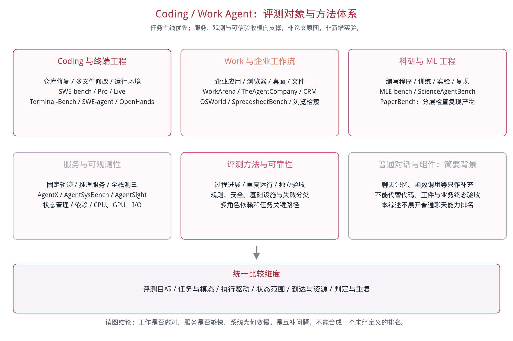
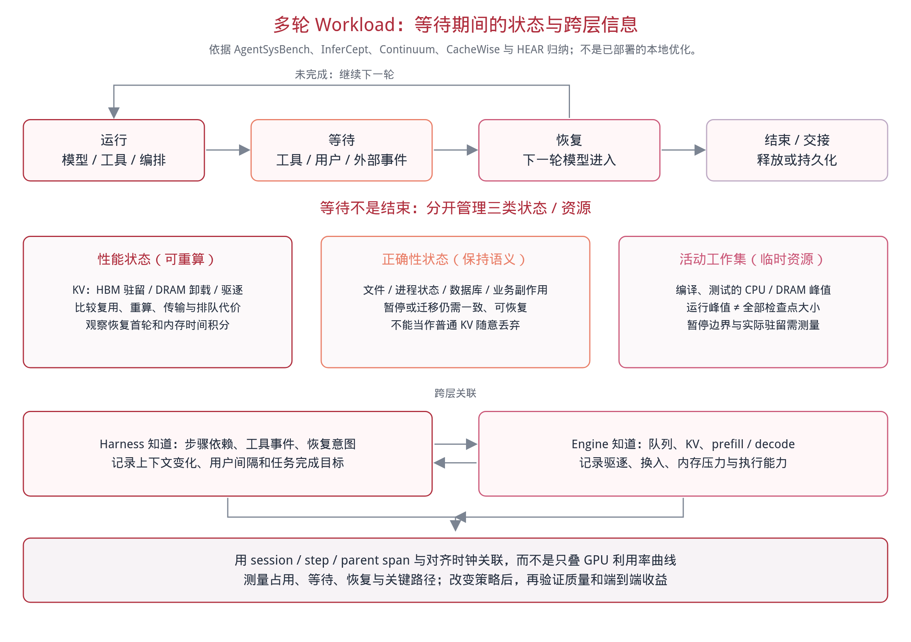
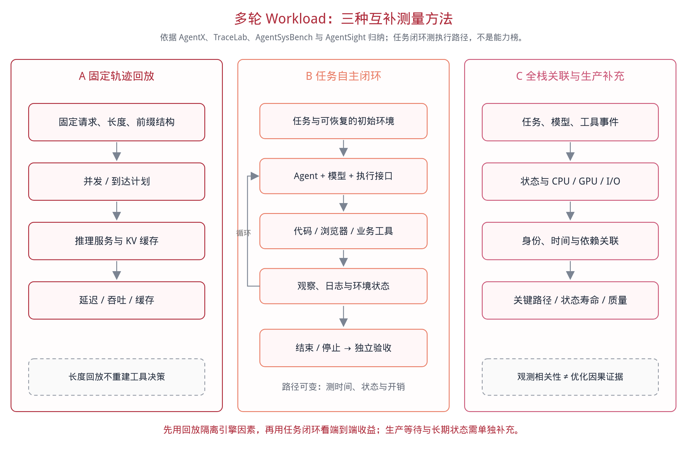
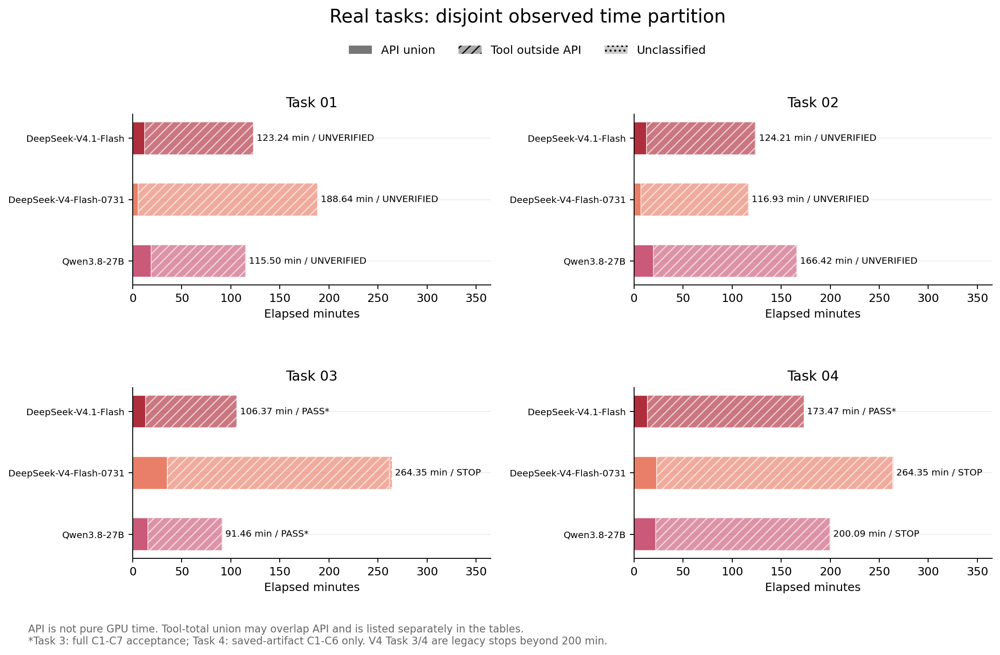
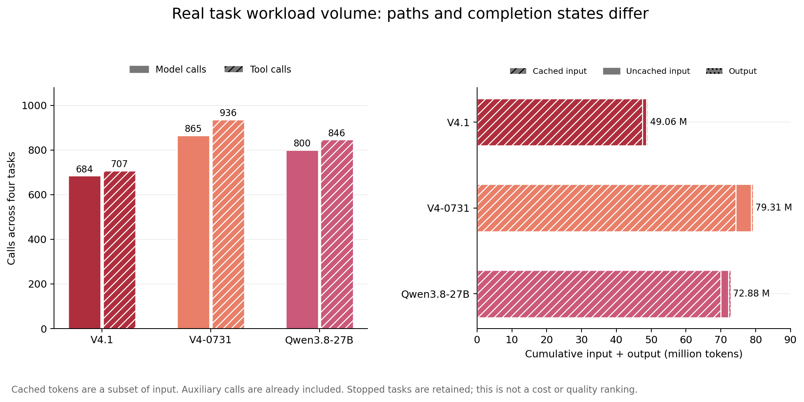
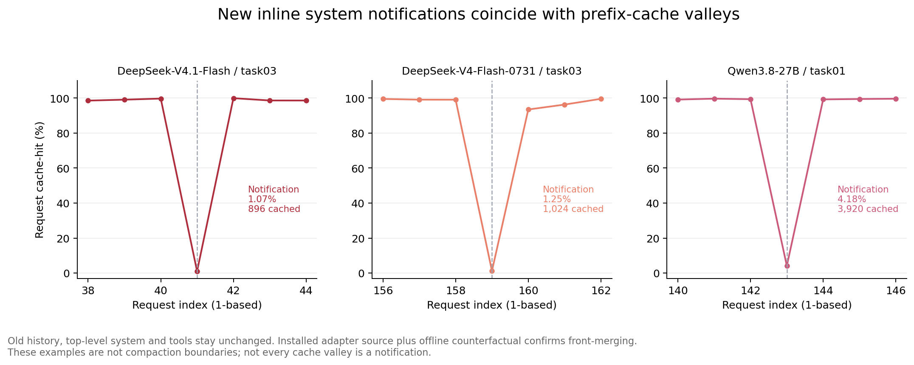
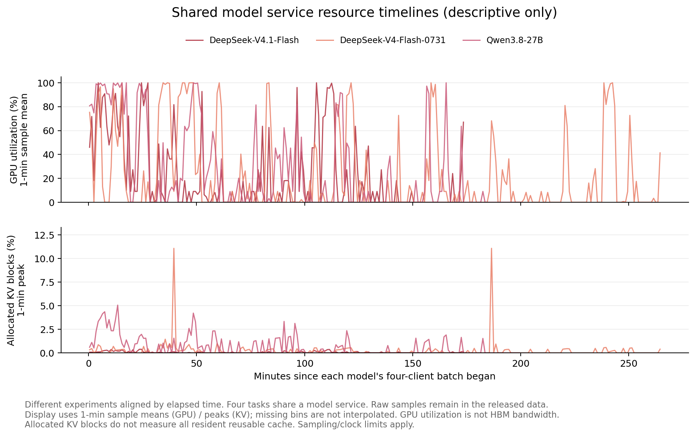
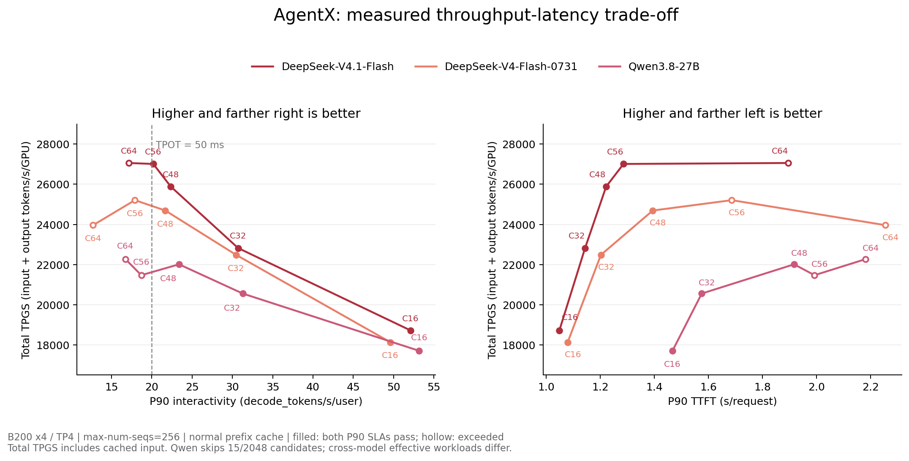

# Agent Workload Serving Study

面向Coding / Work Agent场景的多轮Workload分析调研，以及三模型服务回放与真实任务实验。

应用目标：在prefill芯片方案已确定、decode芯片尚在设计的条件下，找出多轮Agent负载需要注意的计算、KV内存、互连与运行时瓶颈。

[中文技术报告](paper/report.zh-CN.md) · [PDF下载](paper/report.zh-CN.pdf) · [Workload研究索引](docs/literature-index.md)

[多轮Workload研究](#多轮workload研究应分析什么)与[本地实验结果](#本地实验与主要发现)并列展开。调研研究负载如何形成时间和资源压力，不评选哪个Coding/Work Agent能力更强；实验部分完整保留真实任务验收、耗时、调用、缓存和硬件结果。

## Decode芯片设计：已有依据与待验证问题

已有文献直接涉及多轮P/D分工。优先问题是：后续轮次仅新增少量输入时，送到P端处理，还是在D端利用已有KV更划算？其次，高命中不免除decode的历史KV访问；工具等待还会延长状态寿命。不能只按纯单token算子或峰值算力设计，也不能直接把GPU上的现象解释为ASIC结论。

| 设计关注点 | 可直接引用的依据 | 需要针对目标芯片验证的量 |
|---|---|---|
| 小规模增量prefill与P/D交接 | [PPD](https://arxiv.org/abs/2603.13358v2)、[AMPD](https://arxiv.org/abs/2602.14516v2)，ICML 2026 | 本地/远程处理交叉阈值、decode干扰、历史访问和增量KV传输 |
| 长上下文KV数据通路 | [TraceLab](https://arxiv.org/abs/2606.30560v2)、[vLLM DCP](https://vllm.ai/blog/2026-08-07-decode-context-parallelism) | attention真实访存、KV布局/副本、分片后的通信与收益 |
| 等待期间的状态容量与恢复 | [CacheWise](https://arxiv.org/abs/2606.16824v1)、[Continuum](https://arxiv.org/abs/2511.02230v7) | 固定活跃batch后，暂停状态导致的驱逐/恢复与容量拐点 |
| 主机供给与碎片化执行 | [Architectural Implications](https://arxiv.org/abs/2608.04458v1)、[HEAR](https://arxiv.org/abs/2610.06597v1) | 提交/调度间隙、突发恢复、优先级与计算通信重叠 |
| 计算—内存—互连的投入取舍 | [LLMCompass](https://github.com/PrincetonUniversity/LLMCompass)、[HeteroPanacea](https://arxiv.org/abs/2608.03741v1) | 经实测校准的参数敏感性、功耗/面积/成本约束下的收益 |

PPD的一类基线是单向P→D；AMPD远程路径必要时读取D端历史，再返回新增KV。不能说所有PD系统都会重算完整历史，也不能把“返回增量”说成完全没有历史传输。DCP是工程测量，HeteroPanacea的自定义NPU是模拟，LLMCompass是通用硬件方法；均非本地已验证的芯片设计结论。

四组实验设计，均待执行：

1. E1：固定历史长度与实际decode batch，拆解attention、FFN/MoE、量化、通信和提交开销，测真实时间与字节。
2. E2：固定活跃batch，增加暂停会话和KV工作集，区分容量、卸载恢复带宽与驻留策略。
3. E3：比较D端本地增量处理与P端远程处理，扫描增量长度、负载及链路，测后续轮次TTFT和其他请求的逐token尾延迟。
4. E4：用实测校准模型，固定prefill方案，在可行的功耗/面积/成本约束内比较decode计算、内存及互连投入。

完整依据见[报告第2.10节](paper/report.zh-CN.md)，输入、指标、独立重复和四组实验协议见同报告第3.6节。保留真实输出与轮间关系，不固定输出为1；以SLA内输出goodput及逐token尾延迟为主要判断，不能用含缓存输入的Total TPGS代替decode效率。尚无目标规格时只做参数化分析，不给出未经验证的GB或TB/s要求。本次仅更新调研和方案，未增加GPU测试结果。

## 多轮Workload研究：应分析什么

这里的“多轮”指模型—工具—观察反复执行、上下文和状态跨轮存活，不只是用户多次聊天。重点回答三个系统问题：

1. 每轮究竟新增或重算多少？长输入包含大量复用历史，实际prefill量、新增信息与decode工作不能混为一谈。
2. 模型不运行时，资源发生什么？工具/用户等待期间，KV、沙盒和业务状态仍可能存活，影响驻留、卸载、恢复及并发容量。
3. 请求更快是否使整个工作更快？要关联排队、模型、工具、控制面和共享资源，按关键路径及质量/SLA约束判断收益。



| 分析事项 | 需要回答的问题 | 应观察的量或图 |
|---|---|---|
| 循环与阶段 | 一个需求要进入模型多少次，何时返工或分支？ | step/工具次数分布、阶段转换、依赖图 |
| 上下文演化 | 输入增长来自新内容还是旧历史，何时压缩？ | prefix/未缓存/新增/输出随step变化 |
| 缓存与重算 | 为何不命中：前缀改变、过期还是驱逐？ | 条件命中率、实际prefill、前缀一致性、恢复延迟 |
| 间隔与状态 | 等待多久，哪些状态持续占资源？ | 工具/用户间隔分布、KV/沙盒GB·s、恢复首轮 |
| 整任务关键路径 | 模型加速能缩短多少整题时间？ | API/工具/编排互斥分解、重叠DAG、任务尾延迟 |
| 控制面与工具冗余 | 摘要、工具定义、重复搜索/读取花了多少？ | 辅助调用/Token占比、上下文组成、可安全复用上界 |
| 资源与阶段耦合 | GPU低负载时是在等CPU、磁盘还是网络？ | 关联执行阶段的CPU/GPU/I/O/带宽及干预对照 |
| 并发与有效收益 | 质量和SLA达标时能服务多少工作？ | 到达/并发扫描、有效吞吐、任务完成时间、公平性 |

### 直接相关的Workload研究

| 代表工作 | 日期 | 研究对象与切面 | 重点学到的分析方法 |
|---|---|---|---|
| [HEAR](https://arxiv.org/abs/2610.06597v1) | 2026-10-05 | Harness与engine的双向信息接口 | 交换工作流/生命周期意图和队列/KV状态，支持跨层协同 |
| [AgentX](https://github.com/SemiAnalysisAI/agentx-harness) | [2026-08-24](https://inferencex.semianalysis.com/blog/agentx-inferencexv3-does-cuda-moat) | 真实coding轨迹的长度与前缀共享结构回放 | 保留会话依赖、上下文增长与复用；比较延迟约束下的吞吐/交互速度，回放不执行真实工具 |
| [AgentSysBench](https://arxiv.org/abs/2608.15127v1) | 2026-08-15 | 受控部署与生产多组件负载 | 模型之外的耗时、持久状态、控制面成本与工具冗余 |
| [vLLM DCP](https://vllm.ai/blog/2026-08-07-decode-context-parallelism) | 2026-08-07 | 长上下文Agent轨迹下的官方工程测量 | 对照KV复制/序列分片，联合看容量、访存与通信 |
| [Architectural Implications](https://arxiv.org/abs/2608.04458v1) | 2026-08-05 | 生产与受控环境中的碎片化执行 | 分析突发、资源角色、局部性和共享干扰 |
| [HeteroPanacea](https://arxiv.org/abs/2608.03741v1) | 2026-08-04 | P/D与Attention/FFN异构配置模拟 | 结合阶段算子和互连建模；组件验证不能代替完整多轮服务验证 |
| [Copilot生产轨迹](https://arxiv.org/abs/2608.00101v1) | 2026-07-30 | 大规模用户轮次与轮内自主循环 | 分开轮内/跨轮命中，关联空闲、压缩和模型切换 |
| [TraceLab](https://arxiv.org/abs/2606.30560v2) | 2026-06-29 | 真实Claude Code/Codex轨迹 | 分开session、用户需求和模型step；分析append、工具长尾与人类间隙 |
| [CacheWise](https://arxiv.org/abs/2606.16824v1) | 2026-06-15 | Coding循环中的KV压力与前缀复用 | 联合分析工具间隔、驱逐/重算及整session完成时间 |
| [Agentic AI Workload Characteristics](https://arxiv.org/abs/2605.26297v2) | 2026-05-25 | Agent—服务端端到端跟踪 | 测缓存后的真实计算结构、重复进入及工具行为阶段 |
| [PPD](https://arxiv.org/abs/2603.13358v2) | 2026-03-09 | 多轮P/D分离与增量prefill路由 | 测本地增量处理、decode干扰与KV交接之间的取舍 |
| [AMPD](https://arxiv.org/abs/2602.14516v2) | 2026-02-16 | 多轮P/D部署、增量路由与调度 | 联合建模历史/增量、负载和传输，不能只看总ISL/OSL |
| [Continuum](https://arxiv.org/abs/2511.02230v7) | 2025-11-04 | 工具暂停期间的KV驻留与程序调度 | 用恢复/排队成本设置驻留TTL，验证整job时间与稳健性 |
| [CPU-Centric Perspective](https://arxiv.org/abs/2511.00739v3) | 2025-11-01 | CPU工具/编排与CPU—GPU重叠 | 定位宿主侧关键路径和混合负载的队首阻塞 |
| [Autellix](https://arxiv.org/abs/2502.13965v1) | 2025-02-19 | 程序级调度与累积等待 | 关联各次调用的服务历史，优化程序完成时间而非单次API |
| [Parrot](https://arxiv.org/abs/2405.19888) | 2024-05-30 | 应用数据流与模型请求依赖 | 将应用完成目标与请求调度、前缀共享关联 |

日期口径：论文采用arXiv v1首次提交日期，不是当前修订版或会议日期；AgentX采用SemiAnalysis官方发布公告日期，vLLM DCP采用官方博客日期。表中链接仍指向本报告所引用的版本。表内区分轨迹、系统、工程和模拟研究；LLMCompass另作为通用硬件方法收录，不冒充Agent负载论文。



上图区分可重算KV、必须保持语义的文件/业务状态，以及临时工作集。等待不是结束，也不是免费；保留、卸载与重算要连同排队和恢复开销比较。



核心索引涵盖23项负载/系统研究、工具与硬件方法；SWE-bench、Terminal-Bench、WorkArena、TheAgentCompany仅作为4项场景背景，普通多轮聊天一笔带过。三图是文献方法的归纳重绘，不是论文原图或新增实验；研究口径与边界见报告第2节。文献中的优化收益不冒充本地实测。

## 本地实验与主要发现

模型：DeepSeek-V4.1-Flash、DeepSeek-V4-Flash-0731、Qwen3.8-27B。保留 15 个 AgentX 并发测点、12 组真实代码任务、2349 次正式请求，以及 CUDA Graph 和动态通知专项分析；没有运行上述全部基准。

### 1. 真实任务：完成状态与实际耗时

每个模型使用四个隔离的 Claude Code 客户端，分别自主完成源码修复、容器准备、量化验证和图优化任务；四客户端共享该模型服务，彼此不协作。记录从客户端开始到交接/停止的完整耗时，包含工具运行与等待；服务加载和独立验收另计。



| 真实任务 | V4.1(min/状态) | V4(min/状态) | Qwen(min/状态) |
|---|---|---|---|
| 任务1：前缀缓存与Prefill调度修复 | 123.24/自报完成 | 188.64/自报完成 | 115.50/自报完成 |
| 任务2：PP/offload槽宽与几何处理 | 124.21/自报完成 | 116.93/自报完成 | 166.42/自报完成 |
| 任务3：GTCRN ConvTranspose量化修复 | 106.37/完整验收通过 | 264.35/历史中止 | 91.46/完整验收通过 |
| 任务4：ViT量化图冗余操作优化 | 173.47/已有产物验收通过 | 264.35/历史中止 | 200.09/限时未完成 |

12组执行中，3组通过相应独立验收、6组自报完成但隐藏未验、3组停止。V4.1在任务3和任务4通过相应验收，Qwen在任务3通过；不能把任务1/2的自报当作通过，也不能直接合成统一成功率。

任务3验收覆盖C1～C7、重新量化与7个数值用例；任务4只验已有产物C1～C6，不含重新量化/推理。V4任务3/4在新增限时前已运行264.35分钟，保留历史中止状态；Qwen任务4按200分钟上限停止，不能将它们当作严格同限时对照。每模型每题仅一次正式执行。

### 2. 真实任务：单次推理更快，整题不一定更快

本批任务中，模型API区间占整题耗时的3.07%～16.85%，不与API重叠的工具区间占82.80%～96.79%。优化模型服务只能直接影响其中一部分时间；安装、编译、测试、返工和等待也需要分析，不能直接把全部工具区间称为CPU计算或可消除的空闲。

结果解读：本次主要时间落在工具与等待区间，因此仅提高模型服务速度，未必能按同等比例缩短整题时间，还取决于工具路径、等待和并行重叠。已有研究也发现了类似规律：[AgentSysBench（§4.1）](https://arxiv.org/html/2608.15127v1)发现10类应用中有5类由非模型组件主导关键路径；[TraceLab（§6）](https://arxiv.org/html/2606.30560v2)发现超过1分钟的工具调用约占4%，却贡献85%的累计工具调用时间；[CPU-Centric Perspective](https://arxiv.org/html/2511.00739v3)在其工具主导负载中测得CPU侧工具处理最高占端到端延迟的88%。这些研究支持进一步拆分工具执行、调用开销与等待，但各研究计时口径不同，85%不是整题占比，不能与本次百分比直接比较，也不能据此认定本批任务全部受CPU限制。

两模型均通过完整验收的任务3，展示了这个区别：

| 任务3耗时 | V4.1 | Qwen |
|---|---:|---:|
| 整题(min) | 106.37 | 91.46 |
| 模型API(min/占整题) | 13.16/12.38% | 15.41/16.85% |
| 工具不与API重叠(min) | 92.82 | 75.73 |

Qwen整题约快15分钟，但API耗时反而更长，主要时间差出现在工具执行路径和等待，而非API提速。反过来，AgentX中V4.1更高的可行并发，也不能保证每道自主任务都先完成。这是本次单轮执行的结果，不是重复试验后的稳定模型排名。

上方堆叠图使用互斥分解；模型API包含请求往返，不等于纯GPU计算。工具总区间可能与API重叠，不能将两者直接相加。12组逐题API、工具总耗时及占比见[真实任务明细](tables/real_tasks.md)。

### 3. 真实任务：调用与Token开销



| 模型 | 模型调用 | 工具调用 | 累计完整输入token | 累计输出token |
|---|---:|---:|---:|---:|
| V4.1 | 684 | 707 | 48635500 | 428107 |
| V4 | 865 | 936 | 78695937 | 613717 |
| Qwen | 800 | 846 | 72165483 | 712522 |

当前四题执行中，V4.1累计调用和token更少，但不同模型路径与结束状态不同，不能把累计开销直接当作等质量任务的成本排名。21次可识别摘要调用已包含于2349次模型调用中；129个工具错误标记也不等于129项测试失败。[逐题调用与Token表](tables/calls_tokens.md)保留明细。

逐题token加权命中率为90.01%～98.51%，仍未消除大量工具与等待耗时。累计输入含反复发送的历史，不是同等数量的全新信息；高缓存率不等于整个任务已经高效。

### 4. 真实任务：缓存波谷不全是上下文压缩



三个正式服务均观察到通知相关缓存深跌：图中V4.1、V4、Qwen示例分别由99.70%→1.07%、99.06%→1.25%、99.34%→4.18%，之后恢复。下降时命中token本身减少，不只是输入变长导致分母增大。

| 本次标注事件 | 数量 | 已有解释 |
|---|---:|---|
| 上下文压缩 | 20 | 客户端重建历史，前缀发生变化 |
| system前缀变化 | 46 | 动态通知/提醒被兼容层并入开头，长历史无法继续匹配原前缀 |
| 输入增长、分母稀释 | 28 | 命中token未减少，但总输入增加，比例下降 |

客户端将任务通知追加在历史末尾；核验的兼容转换却把内嵌system合并到开头，破坏了已有前缀。固定system位于开头本身合理，问题是动态运行信息与固定指令合并。正式DeepSeek服务的vLLM版本为`0.29.1rc1.dev573+ge97573215`，Qwen派生镜像为`0.26.0`，客户端为Claude Code `2.1.241`；不泛指所有版本。

独立链路上升级到Claude Code `2.1.280`后，通知相关失效仍出现；仅移除通知的请求对照能恢复命中，但没有重新核验该链路的转换源码，也没有测修复后TTFT收益。这94处是指定规则下的标注，不是全部波谷的因果普查，更不能全部归为HBM不足。详见报告第5.6～5.7节及[环境版本](docs/environment.md)。

### 5. 真实任务：硬件负载呈阶段性，而非全程高负载



GPU利用率曲线在推理活跃期与低负载期之间切换，没有表现为整题全程持续高负载；这与工具/等待占主要时间的观察相符，但不足以给全部低负载区间作因果归因。四题共享一个模型服务，图按各模型批次开始时间分别对齐，不是三模型同时部署，也不能把某个峰值直接归给单题。

图中GPU为每分钟样本均值，KV为每分钟已分配块峰值，无采样处不插值。GPU利用率不是HBM带宽，已分配KV块也不等于全部可复用缓存驻留；当前证据不能宣称已定位硬件物理极限。资源细节及共享环境限制见报告第5.3、6.3节。

### 6. AgentX：延迟约束内的服务吞吐

固定256会话、2048条候选请求，测量C16/32/48/56/64；会话内串行、会话间并行，B200×4/TP4，正常前缀缓存，`max-num-seqs=256`。每个测点启动全新服务，从会话首轮开始统计，不复用上一测点KV。



| 模型 | 最高已测可行并发 | P90 TTFT(s) | P90 TPOT(ms) | Total TPGS |
|---|---:|---:|---:|---:|
| V4.1 | 56 | 1.286 | 49.53 | 27010.95 |
| V4 | 48 | 1.394 | 46.12 | 24691.91 |
| Qwen | 48 | 1.917 | 42.77 | 22014.20 |

SLA同时要求P90 TTFT≤10 s、P90 TPOT≤50 ms。当前已测边界由TPOT区分，V4.1到C64时吞吐增加不足0.2%，TPOT却升至58.26 ms；提高并发不再带来约束内收益。Total TPGS为含缓存输入的逻辑总token吞吐/秒/GPU，不是decode吞吐。

Qwen超上下文跳过15条，仅执行2033条，跨模型不是严格共同有效集合；最高已测可行并发不等于生产容量。每点只有一轮，P90达标也不保证P99：V4.1 C56的TTFT P99仍为33.054 s。完整结果见[AgentX汇总](tables/agentx_summary.md)与[分位数表](tables/agentx_percentiles.md)。

### 7. 受控消融：执行路径收益与缓存额外优势分开判断

V4.1在C4、正常缓存下，仅将`FULL_AND_PIECEWISE`切为`FULL_DECODE_ONLY`，严格配对后的服务端首token耗时平均增加221.18 ms（公开112条）/318.60 ms（内部100条），排除了首次调度前的排队区间。但配对差中位数接近零，均值受部分长尾影响，不是每条请求固定收益，也不能全部解释跨模型差距。

早期正常缓存/零命中的多轮比较，则不足以证明V4.1在缓存命中时具有稳定更大的跨模型额外优势：需要看绝对差和运行间波动，不能只比较不同分母的降幅百分比。两项结论回答不同问题。详见报告第5.4～5.5节、[Graph与缓存消融](docs/ablations.md)。

## 数据与复现

- [数据说明](data/README.md)、[证据指纹](data/provenance.json)
- [AgentX 汇总](tables/agentx_summary.md)、[完整分位数](tables/agentx_percentiles.md)、[有效数据集](tables/dataset.md)
- [真实任务耗时与占比](tables/real_tasks.md)、[调用与 Token](tables/calls_tokens.md)
- [环境与版本](docs/environment.md)、[消融补充](docs/ablations.md)、[复现范围](docs/reproducibility.md)

```bash
python3 scripts/analyze.py
python3 -m pip install -r requirements.txt
python3 scripts/plot.py
python3 scripts/verify.py
```

重建文献索引、三张调研图与同源 PDF，还需 Chrome/Chromium 和中文字体：

```bash
python3 -m pip install -r requirements-docs.txt
python3 scripts/survey.py
python3 scripts/build_pdf.py
python3 scripts/verify.py
```

数值分析与校验使用 Python 标准库，实验绘图使用 Matplotlib；文献图/PDF 使用独立无头浏览器。均不需要 GPU 或模型 API。命令在仓库根目录执行；详见[复现说明](docs/reproducibility.md)与[校验摘要](verification.json)。PDF 由报告 Markdown 直接生成，[构建记录](paper/report_pdf.json)保存正文和图像指纹。

原始提示词、题目源码、工具输入输出、账号及部署地址不在仓库内。只提供脱敏测量数据和图表；不能据此独立重跑未公开任务或验证隐藏答案。第三方论文、软件、数据与任务材料的权利归原权利人，不随本仓库重新授权。
