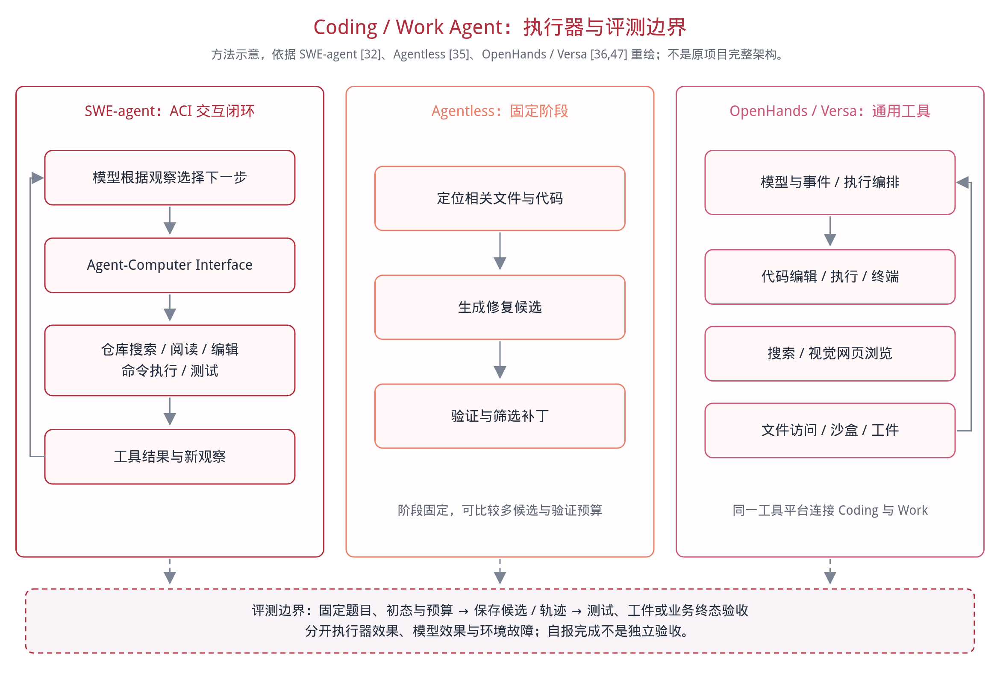

# Agent Workload Serving Study

Coding / Work Agent 评测方法调研，以及三模型推理服务与真实任务实验。

[中文技术报告](paper/report.zh-CN.md) · [PDF 下载](paper/report.zh-CN.pdf) · [43 项文献方法索引](docs/literature-index.md)

## 调研重点与结论

以代码修复、终端工程、企业办公、浏览器/桌面和科研工程为主线；普通多轮聊天与记忆只作简短背景。依据原论文及作者项目梳理代表性方法，截至 2026-10-20；不是穷尽式系统综述或跨榜单分数排名。

1. 任务题库、Agent 执行器和验收器是三个不同对象，必须分别固定版本；自报完成、调用成功不等于代码或业务交付合格。
2. 评测正从局部答案/动作扩展到长流程、跨应用和可验证产物；需要同时看质量、完整任务耗时及资源，而非只看单次推理速度。
3. 固定轨迹回放、自主任务执行、全栈观测互补：分别回答服务能多快、任务能否做对、时间与资源花在哪里。


| 研究主线 | 代表工作 | 任务与验收重点 | 对性能研究的启示 |
|---|---|---|---|
| 仓库修复与长时开发 | SWE-bench / Pro / Live | 问题、代码仓库与测试 | 冻结任务快照、依赖和验证器；耗时包含返工与测试 |
| 终端工程与执行器 | Terminal-Bench 2.0、SWE-agent、Agentless、OpenHands / Versa | 终态产物；ACI、自主循环或固定阶段 | 执行器会改变调用路径，不能把所有差异归给模型 |
| 企业工作流 | WorkArena / ++、TheAgentCompany、CRMArena-Pro | 跨步骤业务状态、交付和规则 | 观察依赖、等待、权限与跨应用开销 |
| 网页、桌面与检索 | WebArena、OSWorld、AssistantBench、BrowseComp | 环境终态或可核验答案 | GUI、视觉、浏览和页面漂移不能只用文本吞吐解释 |
| 表格与科研工程 | SpreadsheetBench / 2、MLE-bench、ScienceAgentBench、PaperBench | 文件、程序、实验及分层产物 | 区分实现、运行、数值和结论；计入被启动程序的资源 |
| 服务与全栈观测 | AgentX、AgentSysBench、AgentSight；SGLang、Parrot、InferCept | 延迟、状态复用、依赖与资源关联 | 回放不判题，资源相关性不代替因果验证 |



上图对比 SWE-agent 的 ACI 闭环、Agentless 的定位—修复—验证流程，以及 OpenHands / Versa 的通用工具执行平台。它们不是同一层次的“题库”，不能把框架效果与模型效果混排。


三张调研图均依据文献抽象重绘，不是论文原图或新增实验。具体来源、协议和适用边界见报告第 2 节及文献索引。

## 本地实验与主要发现

模型：DeepSeek-V4.1-Flash、DeepSeek-V4-Flash-0731、Qwen3.8-27B。保留 15 个 AgentX 并发测点、12 组真实代码任务、2349 次正式请求，以及 CUDA Graph 和动态通知专项分析；没有运行上述全部基准。

当前 AgentX 子集与 P90 SLA 下，V4.1 的最高已测可行并发为 56，V4 与 Qwen 为 48；真实任务主要时间落在工具与等待，回放性能不能直接预测整题耗时；动态 system 通知前置是已验证的前缀缓存失效机制之一。容量、泛化和修复收益的证据边界在正文单独说明。


## 数据与复现

- [数据说明](data/README.md)、[证据指纹](data/provenance.json)
- [AgentX 汇总](tables/agentx_summary.md)、[完整分位数](tables/agentx_percentiles.md)、[有效数据集](tables/dataset.md)
- [真实任务耗时与占比](tables/real_tasks.md)、[调用与 Token](tables/calls_tokens.md)
- [环境与版本](docs/environment.md)、[消融补充](docs/ablations.md)、[复现范围](docs/reproducibility.md)

```bash
python3 scripts/analyze.py
python3 -m pip install -r requirements.txt
python3 scripts/plot.py
python3 scripts/verify.py
```

重建文献索引、三张调研图与同源 PDF，还需 Chrome/Chromium 和中文字体：

```bash
python3 -m pip install -r requirements-docs.txt
python3 scripts/survey.py
python3 scripts/build_pdf.py
python3 scripts/verify.py
```

数值分析与校验使用 Python 标准库，实验绘图使用 Matplotlib；文献图/PDF 使用独立无头浏览器。均不需要 GPU 或模型 API。命令在仓库根目录执行；详见[复现说明](docs/reproducibility.md)与[校验摘要](verification.json)。PDF 由报告 Markdown 直接生成，[构建记录](paper/report_pdf.json)保存正文和图像指纹。

原始提示词、题目源码、工具输入输出、账号及部署地址不在仓库内。只提供脱敏测量数据和图表；不能据此独立重跑未公开任务或验证隐藏答案。第三方论文、软件、数据与任务材料的权利归原权利人，不随本仓库重新授权。
