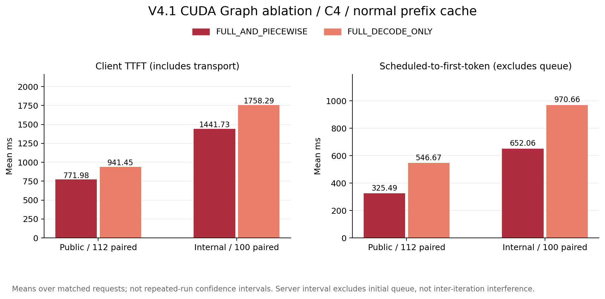
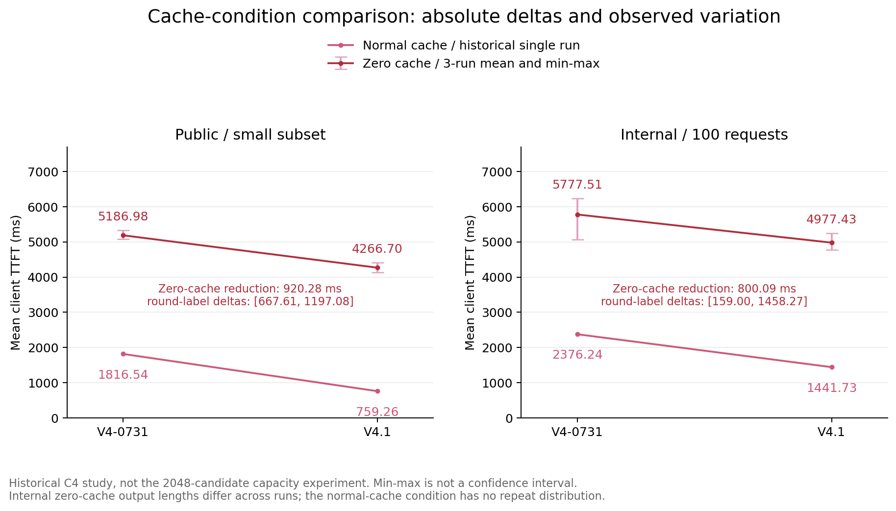
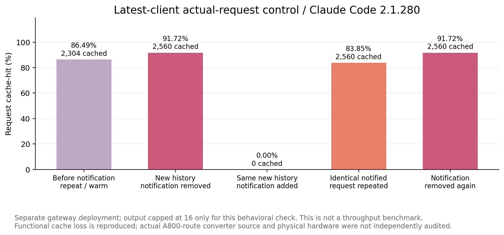

# 从多轮回放到真实 Agent 任务：三模型推理服务性能与前缀缓存行为研究

技术报告 · 2026-10-20 · 基于已完成实验的离线整理

研究对象：DeepSeek-V4.1-Flash、DeepSeek-V4-Flash-0731、Qwen3.8-27B。下文分别简称 V4.1、V4、Qwen；简称不代表额外的模型版本。本报告不是已发表或经同行评审的论文。

## 摘要

单轮推理性能不足以描述多轮 Agent 服务：历史输入重复发送、工具执行和上下文管理都会影响吞吐、延迟与任务完成时间。本文结合 AgentX 固定轨迹回放、四道真实代码任务，以及 CUDA Graph 和动态通知的专项分析，研究三个模型部署的实际表现。AgentX 使用同一批 256 个会话、2048 条候选请求，在 B200×4、TP4、正常前缀缓存条件下测量 C16/32/48/56/64；真实任务采用四个独立 Claude Code 客户端，共保留 12 组正式执行、2349 次模型请求。结果表明：在 P90 TTFT≤10 s 且 P90 TPOT≤50 ms 的约束下，V4.1 的最高已测可行并发为 56，V4 和 Qwen 为 48；真实任务中不与模型 API 重叠的工具区间占总耗时的 82.80%～96.79%，推理服务排序不能直接转化为整题耗时排序；当前 Anthropic 兼容层对动态 system 消息的前置合并破坏了长前缀稳定性，已定位三个正式服务中的 46 处相关缓存深跌。本文同时公开脱敏数值、图表生成脚本及证据指纹，并保留样本跳过、异构软件栈、单轮测量和验收范围等限制。

关键词：Agent workload；多轮推理；前缀缓存；TTFT；TPOT；端到端性能；vLLM

## 1. 引言

推理服务常以请求吞吐、首 token 延迟和生成速度衡量性能。然而，代码 Agent 的一次用户任务可能产生数百次模型调用，并穿插依赖安装、编译、测试和后台任务等待。前一轮的工具结果还会成为下一轮输入，使“请求”与“任务”之间形成明显的层级差异：请求更快，不一定意味着任务更快；高缓存命中率，也不意味着整条工作流已高效运行。

另一类困难来自缓存指标本身。缓存命中率下降可能由上下文压缩、输入增长、消息重排或缓存驱逐引起，表面相似的波谷不一定对应同一根因。直接以命中率高低推断 HBM 容量、以不同基线的相对百分比推断优化的额外收益，都容易混淆工作量、调度和计算路径。

本研究围绕三个问题展开：

1. 在固定多轮回放与明确延迟约束下，三个部署的吞吐—交互速度边界有何差异？
2. 回放中观察到的服务性能优势，能否直接解释真实代码任务的完成时间？
3. 缓存命中条件下的 TTFT 差异及命中率波谷，哪些已有受控证据，哪些仍不能归因？

本文的主要工作是将已有实验统一为可核对的测量口径，而非提出新的推理算法：以固定轨迹描述服务能力，以真实客户端执行描述工作流开销，再用配置消融、安装源码和请求对照缩小根因范围。三类证据分别回答容量、端到端行为和实现机制问题，不将它们混为同一组严格控制变量实验。

## 2. 相关工作

### 2.1. AgentSysBench：从模型推理转向完整工作流

Chang 等的《From LLM Inference to Agentic Workloads: Characterization and Implications for Serving Systems》提出 AgentSysBench，以十类 Agent 应用研究模型、工具、环境和状态的联合行为[1]。其重点包括非模型开销、异构资源与瓶颈迁移、暂停但仍可恢复的会话、控制面开销和跨请求工具复用。本文采用“同时说明工作负载和服务栈”的研究视角，但不是对该论文全部应用或优化方案的复现。

用户提供的 papers.cool 检索入口与 arXiv PDF 指向同一篇论文；检索页及单篇入口用于发现和核对文献，不计为第二项独立研究[2]。方法及论点以 arXiv v1 全文为准，不把摘要中的优化收益当作本地实验结果。

| 本研究关注的问题 | 本地已完成的证据 | 与该研究方向的关系及缺口 |
|---|---|---|
| 模型之外的耗时 | 四道真实任务的 API/工具区间分解 | 有端到端观测；尚未对安装、编译、测试逐项做受控提速 |
| 跨层资源与瓶颈变化 | GPU、KV 块及部分容器 CPU/I/O 时序 | 有相关性线索；无 HBM 带宽和完整关键路径剖析 |
| 长期暂停后的会话恢复 | 真实任务包含后台等待 | 没有生产到达与人工暂停分布，不能外推在线会话容量 |
| Agent 控制面成本 | 摘要调用、上下文压缩和动态通知 | 已定位兼容转换导致的前缀失稳；未测修复后的收益 |
| 工具结果复用 | 固定只读题面 Read 的认证子集 | 范围很窄，不能替代搜索、网页获取等工具的复用研究 |

表中“缺口”是本研究证据的边界，不表示其他工作的结论不成立，也不将相似现象宣称为跨应用普遍规律。

### 2.2. AgentX：轨迹回放与吞吐—交互速度

AgentX Harness 提供多轮轨迹回放及 Weka trace 加载能力[3]。它适合保留输入长度、输出预算和前缀共享结构，从而比较服务配置。本文使用的公开数据集输入由 loader 根据长度与共享 hash 构造，不是逐条恢复真实代码提示词；回放没有执行原始工具，也不评价回答正确性。

vLLM 的 AgentX 可视化展示了吞吐效率与交互速度的权衡[4]。本文借鉴其图形表达，横轴使用明确公式定义的 P90 interactivity，纵轴改为四卡条件下的 Total TPGS。参考页面的成本轴、硬件及最优配置选择不直接移植，本文不计算未核验的 TCO 或美元费用。

### 2.3. KV 缓存与执行优化

PagedAttention 研究 KV 缓存的分页管理、共享与显存浪费问题[5]。vLLM 的前缀缓存和 CUDA Graph 文档分别说明缓存复用与执行图机制[6,7]。缓存能够避免部分重复计算，但仍有未缓存尾部、注意力、调度和传输开销；“命中”不等于后续计算耗时为零。

本文将三件事分开：前缀缓存是否命中、命中后采用什么计算路径、客户端如何组织消息。CUDA Graph 消融研究第二项，动态通知分析研究第三项，二者都不能仅由整体命中率解释。最新版文档也不能替代本次已安装版本的源码审计。

## 3. 方法

### 3.1. 两层测量与根因证据

服务层固定请求轨迹，改变并发，测量请求延迟与完整回放吞吐；工作流层固定题目与客户端约束，允许模型自主调用工具，测量从客户端启动到交接或停止的实际耗时。两层之间不强行固定调用轮数或输出长度，否则会改变真实 Agent 的决策行为。

根因证据分为三类：

- 描述性观测：曲线、运行均值、区间和资源时序，只描述当前执行。
- 配置消融：保持同一模型和其他主要参数，改变 CUDA Graph 模式，按请求身份严格配对。
- 机制验证：核对实际安装的转换源码，再对捕获的请求做离线转换或仅改变通知的行为对照。

不以资源利用率相关性代替因果证明，不把单次运行内的数千条请求当成数千次独立实验重复，也不使用未完成任务的短路径宣称提速。

### 3.2. 请求指标

设请求发送、首个有效生成输出、请求结束的时间分别为 t₀、t₁、t₂，实际输出 token 数为 N：

```text
TTFT = t₁ − t₀
TPOT = (t₂ − t₁) / (N − 1)，仅统计 N ≥ 2 的请求
P90 interactivity = 1000 / P90(TPOT_ms)
```

TTFT 包含初始排队及客户端可见的传输开销；TPOT 是请求内的平均输出间隔，不是逐 token 间隔分布的 P90。这里沿用参考图的 P90 interactivity 命名，其数值定义为 P90 TPOT 的倒数，不是对每个用户的瞬时生成速度取 P90。回放使用客户端 TPOT；真实任务逐请求 TPOT 来自服务端统计，二者不直接混排比较。

ISL/OSL 分别为每次调用的完整输入、实际输出 token 数。报告展示 P50/P90/P99/Max，分位数采用线性插值，token 数展示为整数；原始数值保留插值结果。输出不超过 1 token 的请求仍参与 TTFT、吞吐和缓存统计，但不参与 TPOT。

服务端 `prefill_to_first_token_s` 表示首次调度到首 token，排除了初始 Queue，但可能包含跨调度迭代的干扰；它不是单个 GPU prefill kernel 的净执行时间。客户端 `TTFT−Queue` 仍保留传输和计时边界外开销，不与该字段混称为“纯 Prefill”。

### 3.3. 缓存与吞吐

设输入、缓存命中的输入、输出 token 总量分别为 I、K、O，完整回放耗时为 T，GPU 数为 G：

```text
请求命中率 = cached_prompt_tokens / prompt_tokens
全局命中率 = Σ cached_prompt_tokens / Σ prompt_tokens
请求吞吐 = 请求数 / T
输出 token 吞吐 = O / T
总 token 吞吐 = (I + O) / T
Total TPGS = (I + O) / T / G
Output TPGS = O / T / G
```

全局命中率按 token 加权，不是请求命中率的算术平均。Total TPGS 包含已缓存输入，表示逻辑处理吞吐，不是实际新计算的 token 吞吐，更不是 decode 吞吐。缓存输入是完整输入的子集，不能在 I 之外再次相加。

实际服务的 prefix 查询计数可能包含查找或调度重试，不能一概等同于完成请求的命中总量。回放采用完成请求 usage，并用服务端完成请求记录补齐或核对缺失计数；真实任务按已审计的 Anthropic usage 语义还原完整输入，全部请求与后端记录关联。后文不会把重试口径的 counter 直接当作用户请求缓存率。

### 3.4. 真实任务耗时分解

设 A 为所有模型 API 区间的并集，U 为工具调用区间的并集，E 为该题实际计时窗口。使用如下互斥分解：

```text
总耗时 = |A| + |U \ A| + |E \ (A ∪ U)|
工具总耗时 = |U|
API占比 = |A| / |E|
工具总占比 = |U| / |E|
```

工具总耗时可能与 API 重叠，两项占比不要求相加为 100%；堆叠图只画工具不与 API 重叠的部分。API 区间包含请求往返，不等同于 GPU 计算；工具区间包含运行与等待，后台进程也可能在工具返回后继续活动。“未归类”不自动解释为网络通信或空闲。

### 3.5. 有效性与结果边界

上下文超过当前模型限制的样本跳过，不截断后当作相同工作量；记录跳过数，ISL/OSL 只统计有效样本。并发点之间使用同一模型的固定有效集合；不同模型因 tokenizer、模板和上下文限制不同，有效集合不完全相同。

只有独立验收通过的任务标为通过。自报完成、公开自测、隐藏验收、停止分别记录；验收范围不同的通过结果不能直接合成统一成功率。历史中断轮次与其重测轮次不拼接。全文的“最高并发”均指给定离散测点、数据子集和 SLA 下的最高已测可行值。

## 4. 实验

### 4.1. 实验矩阵与服务环境

| 实验 | 对象与数据 | 控制条件 | 用途 |
|---|---|---|---|
| AgentX 并发回放 | 三模型；2048 条候选；五个并发点 | B200×4、TP4、正常前缀缓存、max-num-seqs=256 | 比较延迟约束内的服务吞吐 |
| CUDA Graph 消融 | V4.1；公开 112 条、内部 100 条配对请求 | C4、正常缓存；主要服务变量仅 Graph 模式 | 定位执行路径贡献 |
| 早期缓存条件复测 | V4/V4.1；公开小子集与内部 100 条 | C4；零命中各三轮 | 比较绝对 TTFT 差及波动 |
| 真实任务 | 三模型×四题，2349 次正式请求 | 每模型四个独立 Claude Code 客户端 | 端到端耗时与上下文行为 |
| 通知机制核验 | 三个正式服务；另有新版客户端小测试 | 安装源码、离线转换、真实请求通知对照 | 区分消息转换与缓存容量问题 |

这五组实验不是同一个请求集合，不能将早期 C4 的高命中率或均值直接填到后期并发曲线上。本文不重新运行推理；所有图表来自已保存结果的离线分析。

正式真实任务的 DeepSeek 服务安装 vLLM `0.29.1rc1.dev573+ge97573215`，Qwen 派生镜像安装 `0.26.0`；Claude Code 为 `2.1.241`。两个服务栈的版本、模板、权重及执行后端不同，因此三模型对比是部署级比较，不是仅改变模型架构的控制变量实验。版本与适配器指纹见[环境证据表](../docs/environment.md)。

V4.1 的专项配置包含 `FLASHMLA_MEGA_ATTN_DSV41`、`nvfp4_ds_mla` 和 128-token block；消融保持这些参数不变，只切换 `FULL_AND_PIECEWISE` 与 `FULL_DECODE_ONLY`。Mega 是融合执行路径，不是另一种前缀缓存；本文没有用单项消融证明它解释全部跨模型差距，也不将该后端名称解释为所有 B200 部署唯一可用或其他 GPU 一定不可用。

### 4.2. AgentX 数据与回放协议

固定选择 256 个会话，每会话前 8 条，共 2048 条候选请求。会话内串行，会话间最多 C 个并行；完成一轮输出后才发送同会话下一轮。不设置缓存命中“预热目标”，从每个会话第一轮开始统计，保留首次未命中。每个并发点使用全新服务，避免复用上一点的 KV Cache。

原始遍历采用较粗粒度，之后补测 C16、C48、C56，形成 C16/32/48/56/64 的最终点集。最终所有点的 `max-num-seqs` 统一为 256，不混入此前较小服务端上限的结果。SLA 同时要求 P90 TTFT≤10 s、P90 TPOT≤50 ms；C64 超标后不继续增加并发。每点只有一次正式测量，不能据此估计运行间置信区间。

| 模型 | 上下文上限 | 有效请求/候选 | 跳过 | 有效会话 | ISL | OSL |
|---|---:|---:|---:|---:|---|---|
| DeepSeek-V4.1-Flash | 1048576 | 2048/2048 | 0 | 256 | 56456/108285/192650/776333 | 382/1762/7402/32370 |
| DeepSeek-V4-Flash-0731 | 1048576 | 2048/2048 | 0 | 256 | 56508/108338/192703/776386 | 382/1762/7402/32370 |
| Qwen3.8-27B | 262144 | 2033/2048 | 15 | 255 | 56084/104963/169787/202988 | 381/1760/7485/32370 |

ISL/OSL 每格依次为 P50/P90/P99/Max，单位为 token。Qwen 的长请求被过滤，跨模型的严格共同有效子集比较尚未补做。两个 DeepSeek 的输出总量各为 1694885 token；Qwen 为 1681345 token。原始输出为 0 的两条候选按接口最低要求设置为 1；各测点有 3 条实际输出≤1 的请求不参与 TPOT。

### 4.3. CUDA Graph 与缓存条件实验

CUDA Graph C4 消融按会话、轮次和请求来源严格配对。公开集两次各有 115 条 profiling 请求，其中 112 条共有；内部集 100 条全部配对。配对公开请求的缓存 token 总量完全相同，未缓存输入仅差 316 token；内部集输入、缓存及未缓存输入完全一致。以服务端首次调度到首 token 为主要执行口径，同时保留客户端 TTFT 和 Queue。

早期缓存条件实验另保留零命中三轮。公开集对六个“模型×轮次”使用共有 112 个请求键；内部集为 100 条有序请求。正常缓存的历史结果没有同等重复分布。内部集零命中的实际输出总量跨轮次和模型存在差异，不属于完全固定输出的重复试验；其范围只能用于描述已观察波动。

### 4.4. 真实任务协议与验收

| 任务 | 内容 | 主要环境或操作 | 可获得的验收范围 |
|---|---|---|---|
| 1 | 前缀缓存与 Prefill 调度修复 | 源码阅读、CPU 测试 | 隐藏材料未提供；只记录自报与公开测试 |
| 2 | PP/offload 槽宽与几何处理 | 源码阅读、边界测试 | 隐藏材料未提供；只记录自报与公开测试 |
| 3 | GTCRN ConvTranspose 量化修复 | 容器、依赖准备、量化及数值验证 | 独立 C1～C7，含重新量化及 7 个数值用例 |
| 4 | ViT 量化图冗余操作优化 | 容器、图优化及产物生成 | 独立已有产物 C1～C6，不重新量化/推理 |

每模型启动四个隔离的 Claude Code 副本。客户端使用模型 API、自主调用工具，不另设 token 总预算；每题上限后调整为 200 分钟，包含依赖准备、运行、等待及续跑，服务加载和独立验收另计。V4 任务3/4在新增限时时已运行约 264.35 分钟，保留原时长及中止状态，不能改写成 200 分钟，也不能当作同一限时下的完整失败对照。Qwen 任务4在约 200 分钟停止，退出开销后实际为 200.09 分钟。

V4.1 被外部同卡进程干扰的旧轮已排除，采用全新重测轮；其余仅使用选定正式轮次。Qwen 使用独立兼容模板将客户端 high 映射到权重默认 xhigh；不同模型的推理力度不视为等价。任务3/4实际使用迁移后的 revision3、环境镜像 1.1，不能将旧题面中镜像 1.0 的操作当作实际执行版本。

采集客户端模型请求、工具事件、压缩事件，关联服务端逐请求计时与 token 数据；同时保存 GPU 利用率、分配 KV 块及可归属容器的部分 CPU/I/O 时序。正式请求全部 HTTP 200、全部关联后端且 token 对账一致。HTTP 成功不表示题目通过，工具错误标记也不等于所有测试失败。

## 5. 实验结果

### 5.1. AgentX：V4.1 扩展了当前 SLA 内的可行并发


图1：左图越靠右上越好，右图越靠左上越好。实心点同时满足两项 P90 SLA，空心点超标。连线只连接实测点，不表示中间并发已经测量，也不是置信区间。右图仅展示约 1～2.3 s 的实测 P90 TTFT 范围；10 s 阈值在范围之外，但达标判断仍使用两项阈值。

| 模型 | C | P90 TTFT(s) | P90 TPOT(ms) | Total TPGS | 全局 Cache-hit(%) | SLA |
|---|---:|---:|---:|---:|---:|---|
| V4.1 | 16 | 1.048 | 19.19 | 18723.12 | 79.13 | 通过 |
| V4.1 | 32 | 1.143 | 32.56 | 22823.58 | 79.13 | 通过 |
| V4.1 | 48 | 1.221 | 44.72 | 25883.64 | 79.13 | 通过 |
| V4.1 | 56 | 1.286 | 49.53 | 27010.95 | 79.13 | 通过 |
| V4.1 | 64 | 1.895 | 58.26 | 27058.94 | 79.13 | 超限 |
| V4 | 16 | 1.079 | 20.16 | 18138.19 | 77.89 | 通过 |
| V4 | 32 | 1.202 | 32.82 | 22484.45 | 77.85 | 通过 |
| V4 | 48 | 1.394 | 46.12 | 24691.91 | 77.85 | 通过 |
| V4 | 56 | 1.686 | 55.84 | 25208.34 | 77.85 | 超限 |
| V4 | 64 | 2.255 | 78.61 | 23963.45 | 77.85 | 超限 |
| Qwen | 16 | 1.467 | 18.81 | 17708.07 | 77.92 | 通过 |
| Qwen | 32 | 1.575 | 31.96 | 20558.59 | 77.83 | 通过 |
| Qwen | 48 | 1.917 | 42.77 | 22014.20 | 77.63 | 通过 |
| Qwen | 56 | 1.992 | 53.47 | 21473.05 | 77.31 | 超限 |
| Qwen | 64 | 2.182 | 59.77 | 22273.52 | 76.97 | 超限 |

在已测点中，V4.1 最高可行并发为 56，V4、Qwen 为 48。C56 的主要区分项是 TPOT，而非 TTFT。V4.1 从 C56 到 C64 的 Total TPGS 增长不足 0.2%，P90 TPOT 却由 49.53 ms 上升到 58.26 ms，因此更高并发并没有带来有意义的约束内吞吐收益。

这并不表示 V4.1 在所有指标上都最优。例如 Qwen 在 C16/32/48 的 P90 TPOT 均略低于 V4.1，但 TTFT 更高，且有效输入总量不同。不能只按单一指标或未归一化工作量给出统一“速度排名”。

P90 达标也不能代表尾部风险已经消失：V4.1 C56 的 TTFT P99 为 33.054 s、Max 为 45.584 s。若要求改为 P99 TTFT≤10 s，当前 C56 结论不再适用。完整 P50/P90/P99/Max 见[分位数表](../tables/agentx_percentiles.md)，请求与 token 吞吐见[汇总表](../tables/agentx_summary.md)。

此外，从 C16 到 C64，V4.1 的全局命中率保持约 79.13%，V4 约 77.85%，Qwen 由 77.92% 下降到 76.97%。本组数据没有出现“相对低并发下降至少 5 个百分点”的现象，因此不能声称已找出 HBM 缓存容量的转折并发，更不能把 C56 的 TPOT 边界归因为缓存容量耗尽。

### 5.2. 真实任务：服务层优势不能直接外推为整题收益


图2：按任务分栏比较三个模型。堆叠部分为 API 并集、工具不与 API 重叠的区间和未归类区间；停止或自报状态不等于通过。任务3与任务4的独立验收范围不同。

| 模型 | 任务1(min) | 任务2(min) | 任务3(min) | 任务4(min) |
|---|---|---|---|---|
| V4.1 | 123.24，自报/隐藏未验 | 124.21，自报/隐藏未验 | 106.37，独立通过 | 173.47，已有产物验收通过 |
| V4 | 188.64，自报/隐藏未验 | 116.93，自报/隐藏未验 | 264.35，历史中止 | 264.35，历史中止 |
| Qwen | 115.50，自报/隐藏未验 | 166.42，自报/隐藏未验 | 91.46，独立通过 | 200.09，限时未完成 |

十二组执行中，有 3 组通过相应独立验收，6 组自报完成但隐藏未验，3 组停止。任务1/2不能据此判为正确或错误，任务4的通过也不覆盖重新量化和新增推理。V4.1 任务3评测 JSON 和量化、数值子进程记录通过，但未单独捕获评测主进程退出码；这一元数据缺口保留。Qwen 任务3实际评测退出码为 0。验收另计耗时分别为 V4.1 任务3 31.67 分钟、任务4 1.85 分钟、Qwen 任务3 31.58 分钟。

各题 API 区间占实际耗时的 3.07%～16.85%，不与 API 重叠的工具区间占 82.80%～96.79%。这说明当前代码任务的已观测时间主要落在工具和等待区间，但不能进一步未经剖析就认定其中全部是 CPU 计算、环境安装或可消除的空闲。完整 API/工具总耗时及占比见[逐题表](../tables/real_tasks.md)。

均通过完整验收的任务3给出了一个直接反例：

| 指标 | V4.1 | Qwen | Qwen−V4.1 |
|---|---:|---:|---:|
| 实际总耗时(min) | 106.37 | 91.46 | -14.92 |
| API 区间(min) | 13.16 | 15.41 | +2.24 |
| 工具不与 API 重叠区间(min) | 92.82 | 75.73 | -17.09 |

Qwen 这次整题更快，但 API 区间反而更多；主要差异出现在工具执行路径和等待。因此，不能用本轮整题差异证明 Qwen 推理更快，也不能用 AgentX 中 V4.1 的优势预测它在每道真实题上必定更快。每个模型每题仅一次正式执行，无法估计稳定的任务级 P90/P99 或通用能力排名。

### 5.3. 调用、Token 与资源：高缓存不等于低工作流开销


图3：四道题累计调用量及 token 量。相同模型使用相同颜色，纹理区分类型。缓存输入是输入的子集，已停止任务仍保留其真实消耗，因此不能把本图当作同等成功工作量下的成本排名。

| 模型 | 模型调用 | 工具调用 | 可识别辅助调用 | 完整输入 token | 缓存输入 token | 输出 token |
|---|---:|---:|---:|---:|---:|---:|
| V4.1 | 684 | 707 | 5 | 48635500 | 47437184 | 428107 |
| V4 | 865 | 936 | 8 | 78695937 | 74277120 | 613717 |
| Qwen | 800 | 846 | 8 | 72165483 | 69990816 | 712522 |

合计 21 次明确识别的摘要调用已包含于 2349 次模型调用，而非额外相加。客户端另记录 129 个工具 `is_error` 结果；它们不能直接换算成失败测试数。不同模型调用路径、输出量和结束状态不同，累计 token 不是模型质量分数，也不使用客户端对本地模型别名估算的美元字段当作真实费用。

逐题 token 加权缓存率为 90.01%～98.51%，高于 AgentX 全会话首轮计入后的约 77%～79%。两者输入结构、上下文长度及轮次数量不同，这不是缓存实现突然发生同等幅度提升的证据。多轮累计完整输入包含反复发送的历史，不能解释为同等数量的全新信息。


图4：不同模型批次按各自开始时间对齐，并非三模型同时部署。为避免高频采样相互遮挡，GPU 使用每分钟样本均值，KV 使用每分钟峰值，无样本的分钟不插值，原始采样保留在数据中。四题共享同一模型服务，资源曲线不能直接归因到某一道题；GPU 利用率不是 HBM 带宽，已分配 KV 块不是全部可复用缓存驻留。容器 CPU/I/O 仅覆盖可归属子集，CPU 百分比可以超过 100%。

### 5.4. CUDA Graph：平均收益存在，但不是每条请求固定省时



图5：V4.1、C4、正常缓存下的严格配对比较。左图为客户端 TTFT，右图为首次调度到首 token 的服务端时间；二者边界不同。

| 数据集 | 配对请求 | Piecewise 服务端均值(ms) | Decode-only 服务端均值(ms) | Decode-only−Piecewise(ms) | 配对差值 P50(ms) | 客户端 TTFT 差(ms) |
|---|---:|---:|---:|---:|---:|---:|
| 公开 AgentX | 112 | 325.49 | 546.67 | +221.18 | -0.02 | +169.47 |
| 内部 Mongo | 100 | 652.06 | 970.66 | +318.60 | -0.25 | +316.56 |

`FULL_DECODE_ONLY` 能正常运行，不存在“强制后必然卡死”的结论。切换为它后，本次配对样本的平均服务端首 token 时间增加，但单请求差值的中位数接近零。均值受部分长尾影响：服务端差值超过 1 s 的请求，公开集为 11/112，内部集为 14/100。因此不能将 221.18 ms 或 318.60 ms 解释为每条请求固定获得的收益。

早期公开集图表的不同请求汇总不能替代本表严格配对后的 169.47 ms；内部集 316.56 ms 是客户端 TTFT 差，不是已排队剔除的 318.60 ms。扣除 Queue 后，客户端差值分别为 169.46 ms 和 352.93 ms，也仍不等同于服务端执行差。

补充的 C1 合成网格中，32K/128K/256K 前缀下客户端“缓存条件额外净收益”约为 29.0/94.1/103.2 ms。它定义为 Piecewise 在正常缓存下的收益减去零命中下的收益，不是正常缓存 TTFT 的全部降幅；尾部实际未命中约 317～323 token，而不是严格 256 token。该网格不能替代真实 C4 负载，更不能外推为五个并发点均有相同净收益。详情及计算定义见[消融补充](../docs/ablations.md)。

### 5.5. 缓存条件对比：应看绝对差和重复波动



图6：早期 C4 小子集的原始客户端平均 TTFT。正常缓存为历史单轮结果，零命中为三轮运行均值及 Min–Max；误差线不是置信区间，也不是请求级分位数。

| 数据集 | 正常缓存 V4/V4.1(ms) | 正常缓存模型差(ms) | 零命中 V4/V4.1 三轮均值(ms) | 零命中模型差(ms) | 同名轮次差的 Min–Max(ms) |
|---|---|---:|---|---:|---|
| 公开 | 1816.54/759.26 | 1057.28 | 5186.98/4266.70 | 920.28 | 667.61～1197.08 |
| 内部 | 2376.24/1441.73 | 934.51 | 5777.51/4977.43 | 800.09 | 159.00～1458.27 |

模型差统一为 V4−V4.1，正值表示 V4.1 更低。Min–Max 是按初始、复测1、复测2的轮次标签分别相减得到的范围，不是所有跨轮组合差，也不代表已做同时段严格配对或显著性检验。

正常缓存下的模型差与零命中均值差相近，且位于上述零命中轮次差范围内。现有证据不足以证明“缓存命中给 V4.1 带来了稳定更大的跨模型额外优势”；同样也不能证明两种条件严格等效，因为正常缓存缺少重复、内部输出量不一致。不同分母下相对百分比仍可描述各自比例，但不能单凭 58% 与 17% 就推导缓存的额外因果收益。

零命中的平均排队显著高于正常缓存历史参考值：公开 V4/V4.1 约 848.70/573.68 ms，内部约 755.13/693.22 ms。因此客户端 TTFT 差同时受到排队、执行和请求序列影响，不能全部归给 prefill kernel。专项 Graph 消融的已验证收益，与这里没有证明稳定的“跨模型缓存额外优势”，是两个不同命题，不矛盾。

### 5.6. 缓存波谷：动态通知前置是已定位的一类根因


图7：三处实际通知事件。新增通知时命中 token 本身下降，随后恢复；不是仅因输入变长导致分母增大。

| 模型/任务 | 请求序号 | 通知前命中率 | 通知加入时 | 后一请求 | 命中 token：前→通知 |
|---|---|---:|---:|---:|---|
| V4.1/任务3 | 40→41→42 | 99.70% | 1.07% | 99.93% | 80384→896 |
| V4/任务3 | 158→159→160 | 99.06% | 1.25% | 93.46% | 68608→1024 |
| Qwen/任务1 | 142→143→144 | 99.34% | 4.18% | 99.23% | 92512→3920 |

客户端原生事件知道它是 `type: system, subtype: task_notification`，但 API 消息对象只有 `role/content`，通知类别保留在 `<task-notification>` 文本标签中。捕获请求表明，固定 system 和工具定义未变，旧历史忽略 `cache_control` 后保持不变，通知追加在历史末尾。因此不能直接认定是客户端把 system prompt 不断加载到开头。

对实际安装源码的核验发现，兼容层为了满足模板约束，在启用 `merge_inline_system` 时把会话中所有 `role: system` 消息并入开头的 system，并跳过原位置。DeepSeek 未显式提供模板时启用该路径；Qwen 模板禁止中途 system，也触发合并。其效果可简写为：

```text
发送时：固定系统指令 → 已有历史 → 新增任务通知
转换后：固定系统指令＋新增通知 → 已有历史
```

前缀缓存必须从起点连续匹配。动态通知改变较早位置后，后面未改变的长历史也不能继续命中原前缀。使用实际转换函数做离线对照，仅移除新增通知即可恢复前一次 leading system；三个示例的 leading system 字符数分别由 4083/5516/38805 增至 5059/6513/39810。这里是字符数，不是 token，也没有测量修复后的 TTFT 收益。

按“命中率下降至少 30 个百分点、当次低于 50%、排除原生压缩边界”的条件筛选并核对，正式请求中发现 46 处系统消息前置相关深跌：V4.1 8处、V4 26处、Qwen 12处。多数是任务通知，少数为其他系统提醒，不能全部称为 `task_notification`，也不能按次数给模型排序。

缓存波谷至少应分三类处理：

| 类别 | 本次标注数量 | 证据与解释 |
|---|---:|---|
| 上下文压缩 | 20 | 原生日志记录压缩，历史被重建；并不都要求达到深跌阈值 |
| system 前缀变化 | 46 | 历史追加内嵌 system，经已核验兼容层前置；满足深跌筛选 |
| 输入增长、分母稀释 | 28 | 命中率下降≥15个百分点，但命中 token 未减少、输入增加 |

这 94 处是按指定规则展示的事件，不是所有缓存波动的完整因果普查。没有 preemption 也不能排除空闲前缀被驱逐；仅凭波谷不能证明 HBM 不足。固定 system 在开头本身合理，问题在于动态运行信息与固定指令合并。修复应同时保留通知语义、位置和指令优先级，不能简单删除通知、把所有 system 改成 user，或添加一个服务端未定义的 `subtype` 字段就认为完成。

### 5.7. 最新客户端验证：现象仍在，部署归因不能越界



图8：另一路用户配置为 A800 的服务入口，以指定来源的 Claude Code `2.1.280` 进行小规模行为验证。该入口经过 LiteLLM `1.98.0`，后端版本接口报告 vLLM `0.28.1rc1.dev688+g5c642796e`；没有重新核验物理 GPU，也没有读取其实际转换源码。

新版实际客户端在临时配置关闭逐轮 token 提醒后，通知前→通知加入→下一请求的命中率为 76.88%→0.00%→79.01%。进一步重放真实请求，仅移除那一条通知时命中 2560 token、91.72%；加入通知时为 0；完全相同的含通知请求再发送后恢复到 2560 token、83.85%；再移除通知仍为 2560 token、91.72%。关键对照保留其余历史与字段，并统一非流式、最多输出 16 token，不执行生成的工具动作。

这证明更新客户端没有消除该链路中的通知相关缓存失效，且不仅是分母效应。它没有独立证明该部署中具体是哪一层前置，也没有评估修复收益；不能把 B200 安装源码的结论和版本直接套到这条链路。默认模式还存在逐轮追加提醒，其缓存变化不单独归因于任务通知。输出 16 仅用于行为对照，不是容量或吞吐测量协议。

### 5.8. 工具复用：当前认证范围不足以推出普遍收益

认证复用仅覆盖固定只读题面 Read，要求输入、权限、源文件和结果指纹等条件满足。V4 有 18 次题内重复、累计工具时间 1.1253 s，其他模型该认证子集为 0；跨题认证重复均为 0。

这只能说明当前子集未发现大收益，不能推广为“工具缓存没有价值”。Bash、可变工作目录、搜索与网页获取不在认证范围；重复调用也不自动等于可安全复用。与相关工作的搜索工具复用研究相比，本地覆盖不同。即使未来减少累计工具秒数，也需重新检查关键路径，不能直接当作整题减少同等秒数。

## 6. 讨论与局限

### 6.1. 已回答与未回答的问题

本研究给出了当前固定子集下的可行并发、真实任务的时间构成，并定位了一个跨三个正式服务出现的消息转换问题。尚不能回答理论最大并发、生产在线会话容量、全数据集上的稳定排名，或修复通知后究竟能节省多少 TTFT/整题时间。

尤其是 C56：其证据是请求级 P90 约束内吞吐较优，不是已证明 GPU 算力、HBM 带宽或缓存容量恰好到达物理极限。并发上升时 TPOT 变差而缓存率稳定，提示应进一步研究执行与调度，但单凭本组曲线不能确定硬件瓶颈。

### 6.2. 公平性与统计有效性

同一模型的不同并发使用相同有效请求与预算，适合描述该部署的并发敏感性。跨模型还存在模板/tokenizer、上下文过滤、软件版本、执行后端、推理力度及自主执行路径差异。真实题限时规则也曾变化；停止任务是删失/未完成观测，不当作成功耗时或严格同限时失败率。

AgentX 每点一次，真实任务每题每模型一次；零命中仅三轮且输出存在变化。请求级 P99 描述一次运行的尾部，不能代替运行间稳定性；Min–Max 不是置信区间。本报告不使用“统计显著”“严格等效”或通用能力胜出等超出证据的表述。

### 6.3. 资源归因与共享环境

使用不同 GPU 不保证 CPU、主存带宽、存储或网络互不干扰。GPU 利用率和容器记录可发现时间上的关联，但缺少完整整机背景负载、HBM 带宽及细粒度 kernel 证据；采样、时钟校准和后台进程覆盖也有限。不能把整机指标全部归给自己的任务，也不能因未看到 preemption 就断言不存在任何缓存驱逐。

### 6.4. 下一步的必要验证

优先进行三项不重复现有指标展示的工作：在共同有效样本上重复关键 SLA 测点并记录运行间波动；对动态通知表示做语义等价的受控修复，验证缓存、TTFT 和端到端收益；结合 CPU/容器、vLLM 与 DCGM/Node Exporter 等采集补齐共享资源和执行关键路径证据。生产到达、长期暂停、状态卸载和搜索工具缓存需要额外工作负载，不假称已由本次连续回放覆盖。

## 7. 结论

1. 在当前 AgentX 固定候选子集、四卡部署和 P90 SLA 下，V4.1 的最高已测可行并发为 56，V4 与 Qwen 为 48；这不是生产最大容量或 P99 保证。
2. 真实任务主要时间落在工具与等待区间，服务层推理差异不能直接等同于整题收益；完成状态与验收范围必须与耗时一起解释。
3. 缓存性能既取决于执行路径，也取决于消息稳定性。Graph 消融提供了平均首 token 时间收益的证据；动态 system 通知前置提供了缓存失效的机制证据，但修复后的实际加速仍待验证。

## 数据与复现声明

本仓库提供脱敏数值、8 组 PNG/SVG、自动汇总表和离线校验/绘图脚本。原始提示词、工具输出、题目源码、账号及部署地址不公开，内部数据仅包含去标识的测量数值，不包含样本内容。内容指纹用于由实验所有者核对来源，不使未公开原始材料自动变成可获取的数据。

读者可重新计算已公开测量值的派生指标、配对差及图表，但不能从请求摘要重新计算所有 AgentX 分位数，也不能仅凭公开材料复现真实任务解题结果或独立验证全部原始消息语义。[复现说明](../docs/reproducibility.md)说明这一区别；[证据清单](../data/provenance.json)记录输入文件指纹。未启动新 GPU 实验，也未将已有 Web 展示当作新的实验重复。

## 参考文献

[1] Chaokun Chang, Yukun Zhou, Kaihua Fu, et al. From LLM Inference to Agentic Workloads: Characterization and Implications for Serving Systems. arXiv:2608.15127v1, 2026. [PDF](https://arxiv.org/pdf/2608.15127) · [全文 HTML](https://arxiv.org/html/2608.15127v1)。

[2] papers.cool. [用户提供的标题检索入口](https://papers.cool/arxiv/search?highlight=1&query=From+LLM+Inference+to+Agentic+Workloads+Characterization+and+Implications+for+Serving+Systems) · [同一论文的单篇入口](https://papers.cool/arxiv/2608.15127)。文献发现入口，不是独立论文。

[3] SemiAnalysisAI. [AgentX Harness](https://github.com/SemiAnalysisAI/agentx-harness)，包括 Weka trace 回放及指标说明。

[4] vLLM. [Agentic serving: cost efficiency vs. interactivity](https://vllm.ai/blog-assets/interactive_pages/vllm-agentx-pareto.html)。本文仅借鉴图形表达，不沿用其成本值或硬件结果。

[5] Woosuk Kwon, Zhuohan Li, Siyuan Zhuang, et al. Efficient Memory Management for Large Language Model Serving with PagedAttention. SOSP 2023. [arXiv:2309.06180](https://arxiv.org/abs/2309.06180)。

[6] vLLM documentation. [Automatic Prefix Caching](https://docs.vllm.ai/en/latest/design/prefix_caching/)。

[7] vLLM documentation. [CUDA Graphs](https://docs.vllm.ai/en/latest/design/cuda_graphs/)。

以上在线资料核对日期为 2026-10-20；文献观点、上游文档和本地实测分开引用。机器可读书目见 [references.bib](../references.bib)。
