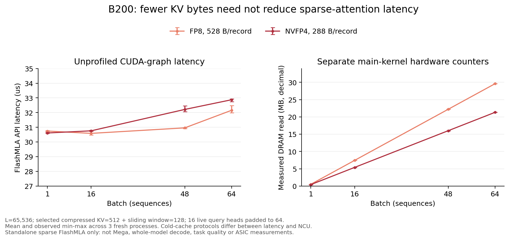
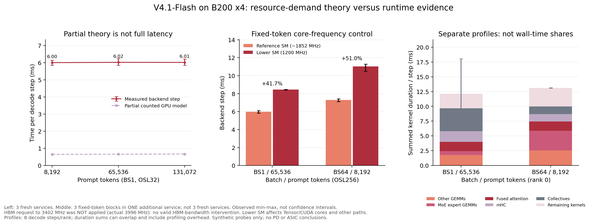

# 从多轮回放到真实 Agent 任务：三模型推理服务性能与前缀缓存行为研究

技术报告 · 2026-10-21 · 已完成实验、文献调研与待执行实验设计

修订重点：在保留Coding / Work多轮负载与真实任务结果的基础上，新增B200四卡资源配比假说验证，区分部分理论、核心频率干预及尚无有效对照的HBM带宽问题。另存[同源PDF版本](report.zh-CN.pdf)。

研究对象：DeepSeek-V4.1-Flash、DeepSeek-V4-Flash-0731、Qwen3.8-27B。下文分别简称 V4.1、V4、Qwen；简称不代表额外的模型版本。本报告不是已发表或经同行评审的论文。

## 摘要

单轮推理性能不足以描述多轮 Agent 服务：历史输入重复发送、工具执行和上下文管理都会影响吞吐、延迟与任务完成时间。本文先调研Coding / Work场景下多轮Workload的上下文增长、轮间等待、状态驻留与关键路径，再结合 AgentX 固定轨迹回放、四道真实代码任务，以及 CUDA Graph 和动态通知的专项分析，研究三个模型部署的实际表现。AgentX 使用同一批 256 个会话、2048 条候选请求，在 B200×4、TP4、正常前缀缓存条件下测量 C16/32/48/56/64；真实任务采用四个独立 Claude Code 客户端，共保留 12 组正式执行、2349 次模型请求。结果表明：在 P90 TTFT≤10 s 且 P90 TPOT≤50 ms 的约束下，V4.1 的最高已测可行并发为 56，V4 和 Qwen 为 48；真实任务中不与模型 API 重叠的工具区间占总耗时的 82.80%～96.79%，推理服务排序不能直接转化为整题耗时排序；当前 Anthropic 兼容层对动态 system 消息的前置合并破坏了长前缀稳定性，已定位三个正式服务中的 46 处相关缓存深跌。本文同时公开脱敏数值、图表生成脚本及证据指纹，并保留样本跳过、异构软件栈、单轮测量和验收范围等限制。

面向prefill芯片方案已确定、decode芯片尚在设计的应用目标，本文进一步梳理增量prefill路由、长上下文KV访问、轮间状态恢复和硬件设计空间方法。文献支持这些机制值得评估，但不能直接确定目标芯片的容量、带宽或计算配比。第3.6节定义四组实验；新增E1单算子与整模型TP4验证见第5.9、5.10节。核心频率下降使decode变慢，但HBM调频未生效，尚不能确定带宽和计算投入的优先级；没有目标ASIC实测结果。

关键词：Agent workload；多轮推理；decode芯片；KV Cache；P/D分离；瓶颈归因；vLLM

## 1. 引言

推理服务常以请求吞吐、首 token 延迟和生成速度衡量性能。然而，代码 Agent 的一次用户任务可能产生数百次模型调用，并穿插依赖安装、编译、测试和后台任务等待。前一轮的工具结果还会成为下一轮输入，使“请求”与“任务”之间形成明显的层级差异：请求更快，不一定意味着任务更快；高缓存命中率，也不意味着整条工作流已高效运行。

另一类困难来自缓存指标本身。缓存命中率下降可能由上下文压缩、输入增长、消息重排或缓存驱逐引起，表面相似的波谷不一定对应同一根因。直接以命中率高低推断 HBM 容量、以不同基线的相对百分比推断优化的额外收益，都容易混淆工作量、调度和计算路径。

本研究的应用目标是：在prefill芯片方案已确定的条件下，识别多轮Coding / Work Agent对decode芯片的特殊压力，支持计算、内存、互连及运行时接口的设计取舍，而非仅给三个模型排序。此前回放与真实任务构成负载和现象证据；芯片级定量结论还需资源归因与经校准的架构评估。

已有实验围绕三个问题展开：

1. 在固定多轮回放与明确延迟约束下，三个部署的吞吐—交互速度边界有何差异？
2. 回放中观察到的服务性能优势，能否直接解释真实代码任务的完成时间？
3. 缓存命中条件下的 TTFT 差异及命中率波谷，哪些已有受控证据，哪些仍不能归因？

本文将已有实验统一为可核对的测量口径：以固定轨迹描述SLA内服务能力，以真实客户端执行描述工作流开销，再用配置消融、安装源码和请求对照缩小根因范围。新增调研则回答哪些多轮机制已有文献依据、哪些设计阈值还需验证。服务能力、端到端行为、实现机制和芯片预测不属于同一组严格控制变量实验，不将它们混同。

## 2. 相关工作

### 2.1. 调研对象：Coding / Work场景的多轮Workload，而非Agent能力

本节研究Coding / Work Agent反复调用模型、执行工具、等待和恢复所形成的系统负载：每轮产生多少新计算，什么状态跨轮存活，时间花在哪里，并发如何影响延迟，以及哪些优化能缩短整任务。它不是Coding Agent框架、题库或解决率综述。普通多轮聊天只用于对照，不单列能力榜。

核心选取23项工作负载研究、服务系统、测量工具及硬件评估方法，另用4项基准说明场景，核对截至2026-10-20。新增PPD、AMPD、vLLM DCP、HeteroPanacea与LLMCompass[27～31]；其中DCP是官方工程材料，LLMCompass是通用硬件方法，不称为专门的Agent轨迹论文。SWE-bench、Terminal-Bench是代码/终端任务来源，WorkArena、TheAgentCompany提供办公/企业任务背景[23～26]。原始来源、研究对象及限制见[Workload研究索引](../docs/literature-index.md)。

计量先统一层级：长寿命session可以含多次用户需求，每次需求又触发多个模型调用及工具动作。TraceLab把用户需求称为request、模型进入称为step[8]；本报告后文“请求”通常指一次模型API调用，不能直接混算两者的每请求成本。四个独立客户端并行也不等于有依赖的多Agent执行图。

### 2.2. 负载结构：模型反复进入、状态持续增长、执行跨越CPU/GPU


图R1：Coding / Work多轮负载的“特征—系统压力—分析量”框架，为本文依据文献归纳的研究问题，不是能力分类或新的测量结果。

不同于把ISL/OSL独立采样的一次推理，下一轮往往依赖上一轮工具结果。轮数、上下文、输出和工具间隔彼此相关：模型越快，后续请求可能越早到达；工具返回越大，下一轮输入也可能越长；压缩、分支或通知又改变可复用前缀。因此，仅保留请求长度直方图会丢失负载的时间结构与共享关系。

应同时观察三条轨迹：执行轨迹记录谁依赖谁、何时具备运行条件；上下文轨迹记录历史、工具输出与压缩如何变化；状态轨迹记录KV、沙盒文件/进程和检索状态在运行、等待、恢复之间怎样占用资源。这三条轨迹共同决定服务压力，而非由Agent名称决定。

### 2.3. 直接相关的多轮负载刻画研究

| 研究 | 数据与测量切面 | 主要分析对象 | 对本研究的启示 |
|---|---|---|---|
| TraceLab[8] | 真实Claude Code/Codex日志，归一session/用户需求/step | 自主循环、上下文、工具长尾、跨用户间隙缓存 | 区分缓存读取、实际prefill与全新信息，保留真实等待 |
| Copilot生产轨迹[9] | 大规模真实使用，分开用户轮次与轮内循环 | 轮内/跨轮复用、用户空闲、模型切换及压缩 | 全局命中率会掩盖边界行为，需条件分组 |
| Agentic AI Workload Characteristics[10] | Agent与服务端联动跟踪，多模型/推理模式 | 反复模型进入、缓存后计算、工具行为阶段 | 长ISL不自动意味着prefill主导，要测实际未缓存工作 |
| AgentSysBench[1] | 受控多组件部署并补充生产轨迹 | 非模型耗时、异构资源、长期状态、控制面和工具冗余 | 联合分析模型、工具、环境与暂停状态 |
| CPU-Centric Perspective[15] | 跨硬件、不同任务与混合负载 | CPU编排/工具瓶颈、CPU/GPU重叠、队首阻塞 | GPU不忙时要定位宿主侧关键路径，而非只加推理卡 |
| Architectural Implications[16] | Azure生产观察与受控框架实验 | 碎片化、突发、角色差异、共享核局部性 | 同一框架也可能随任务/工具改变硬件压力 |

这些研究不是在回答“哪个Agent更会做题”，而是在解释轨迹怎样转化为服务成本。生产日志更能观察用户节奏和长暂停，但存在路由、模型及人群混杂；受控运行更便于改变资源和策略，但不能自动代表生产到达。各文献统计口径与部署不同，不直接相减其命中率或吞吐数值。

### 2.4. 上下文与缓存：长输入、实际prefill、全新信息不是同一个量

TraceLab[8]将输入分为已缓存prefix与待prefill的append；后者还可能含被驱逐或前缀改变后重新计算的旧历史。Copilot轨迹[9]进一步区分轮内与用户轮次边界；工作负载研究[10]显示，在其有效缓存条件下，长历史复用会改变prefill/decode占比。应从“总输入很长”推进到“这一次到底重新算了多少”。

一个仅用于说明口径的例子：历史200K、新工具结果1K，完整输入201K，若命中190K，则实际待prefill为11K，其中1K为本轮新增、10K为未复用旧历史。不能把11K都叫新信息，也不能用201K宣称实际完成了201K的prefill计算。若构建冗余prefill放大率，应以一致口径的实际prefill量除以真正新增量，并处理首轮、压缩和重写；仅靠usage未必能重建后者。

需要按触发事件分别画输入、缓存token、未缓存token、输出及首token延迟：普通工具返回、用户继续输入、上下文压缩、模型/模板变化、system通知、分支切换和长暂停。prefix hash或实际token前缀比对可区分“内容不再匹配”与“内容相同但缓存不在”；客户端usage、服务端查询counter和实际重算也要对账。

PagedAttention[5]、SGLang[20]提供块管理与前缀复用基础，但高命中率不意味着旧历史没有读取/attention成本，也不证明工具工作流高效。普通聊天记忆正确性与KV缓存复用不同，本节不展开聊天记忆基准。

### 2.5. 工具间隔与状态生命周期：等待不是结束，也不是免费


图R2：等待期间的状态管理与采集示意，依据AgentSysBench、InferCept、Continuum、CacheWise及HEAR[1,22,12,11,14]归纳。图示是分析边界，不表示本地已实施卸载或协议改造。

KV属于可重算的性能状态；源码修改、文件、数据库和外部副作用属于需要维持语义的状态；编译期间的工作集峰值又不等于暂停时必须保留的全部状态[1]。只看GPU KV会遗漏沙盒和检索状态，只看内存峰值也会高估检查点大小。

工具等待、后台执行、人类阅读/批准和网络等待应分开记录，并统计持续时间、恢复概率与再次进入模型的时间，而不只统计平均tool latency。相同“Bash”既可能是毫秒查询，也可能是长编译；按工具名平均不足以预测回归时刻。状态应按时间积分为GB·s/GB·min，并记录共享块去重后的实际占用，不能直接将每轮完整ISL相加估算HBM。

| 系统研究 | 利用的负载信息 | 处理的取舍 | 应验证的结果 |
|---|---|---|---|
| InferCept[22] | 外部交互造成的暂停 | 保留、换出或重算上下文 | 占用、传输、恢复首轮延迟 |
| Continuum[12] | 恢复成本、排队与不稳定工具间隔 | 选择性KV驻留TTL，加程序级调度 | 整job耗时及预测失准时表现 |
| CacheWise[11] | 大前缀重用与工具元数据 | 前缀感知调度、复用感知驱逐 | 驱逐/重算量与session完成时间 |
| TokenCake[18] | 有依赖的多Agent图与运行状态 | 等待时卸载，关键路径状态优先 | 工作流延迟、换入代价和内存竞争 |

不能预设等待时全部留在HBM最好，也不能预设全部驱逐最好：要比较省下的重算与增加的排队、挤占、传输成本。TokenCake等多Agent图研究可补充依赖管理，但不能把四个独立客户端当作已验证该拓扑。

### 2.6. 关键路径、控制面与异构资源：请求最优不等于任务最优

Parrot[21]通过数据流依赖连接应用与服务；Autellix[13]把程序级服务信息带入调度，关注累积等待而非只优化单次API；Cortex[17]研究按阶段隔离资源池，减少计算与内存干扰。这些方法共同指出：调度单位、状态单位与用户完成目标需要对齐，但它们并非同一种算法或相同适用场景。

HEAR[14]区分harness知道的依赖/状态生命周期/目标，与engine知道的队列/KV压力/执行能力，并定义双向信息交换。它与工作负载分析直接相关：只采客户端看不见引擎排队，只采GPU又不知道工具何时返回。AgentSight[19]提供通信语义与系统事件的关联思路；观测能力不等于因果证明，也不替代任务验收。

时间应拆到编排与序列化、服务排队、prefill、decode、工具执行/等待、检索及数据移动，再通过依赖图还原关键路径。并行工具或后台命令可能与API重叠，不能简单把全部span相加。CPU、内存带宽、磁盘、网络与GPU的压力会随读文件、编译、测试、浏览等阶段变化[15,16]；其他用户使用不同GPU仍可能共享这些资源。

AgentSysBench[1]还提出控制面成本：工具定义和历史占用上下文、压缩/摘要等辅助模型调用，以及暂停引起的重复prefill。应记录它们的次数、token、耗时和质量影响；工具冗余则要在输入、权限、文件/网页新鲜度和副作用允许时才判断可缓存。减少累计工具秒数或token不一定减少同等关键路径时间。

### 2.7. 测量协议：回放、真实闭环与生产观察互补


图R3：固定轨迹、真实任务闭环与生产/全栈观察的互补关系。方法图为本文归纳，不把文献系统组合成已部署的新系统。

| 方法 | 保留什么 | 适合回答 | 易遗漏什么 |
|---|---|---|---|
| 固定轨迹回放[3] | 请求顺序、长度、共享结构、输出预算；可另保留时间间隔 | 相同工作量下的引擎并发、缓存和SLA | 自主决策、工具语义、真实等待及正确性 |
| 真实任务闭环 | 工具执行、上下文变化、模型决定的下一步 | 整题时间、路径/返工、完成状态和实际开销 | 模型一换，实际工作量也变，难单独归因引擎 |
| 生产/全栈观察[1,8,9,19] | 用户节奏、长暂停、跨层资源与恢复 | 状态寿命、突发、共享资源和真实复用 | 混杂多，仅凭相关性难证明策略收益 |

还要独立说明到达协议：固定C个会话、每会话等响应和工具后再发下一步，是闭环负载；外部会话按时间戳/速率进入，是到达过程的另一维。Agent自主决策闭环与闭环负载不是同一个概念。省略工具或用户等待的“立即继续”回放适合受控压力测试，却改变KV回用距离和活跃请求数，不能称为完整生产轨迹。

容量遍历应固定有效数据、输出、服务资源及缓存初态，区分活跃推理请求、正在工具执行和等待恢复的session。增加并发是否值得，要同时看TTFT/TPOT尾部、有效完成吞吐、排队与公平性；逻辑Total TPGS包含缓存输入，应另报输出吞吐和实际prefill工作，避免把重复历史当新增计算收益。

### 2.8. 这种多轮场景具体应该分析什么

下表是从文献综合出的分析问题与建议输出，不是已完成的新实验或统一官方标准。

| 分析事项 | 要回答的问题 | 核心观测与建议图表 | 主要依据 |
|---|---|---|---|
| 循环与阶段 | 一个需求要重入模型多少次，何处返工/分支？ | 每需求step/工具次数分布、阶段转换、依赖图 | [8,9,10] |
| 上下文演化 | 长ISL来自新增还是重复历史，何时压缩？ | 每step的prefix/未缓存/新增/输出轨迹，压缩前后对照 | [8,10,1] |
| 缓存与重算 | 不命中因内容改变、过期还是资源驱逐？ | 条件命中率、前缀一致性、冗余prefill量与恢复延迟 | [8,9,11] |
| 间隔与状态 | 模型不运行时，状态留多久、占多少资源？ | 工具/用户间隔CDF、KV/沙盒GB·s、恢复首轮延迟 | [1,12,22] |
| 整任务关键路径 | 推理更快是否使整题更快？ | API/工具/编排互斥分解，重叠DAG，整题尾延迟 | [13,21,19] |
| 控制面与工具冗余 | 摘要、工具schema、反复读取/搜索花了多少？ | 辅助调用及token占比、上下文组成、安全复用上界 | [1,8] |
| 资源与阶段耦合 | 是GPU、CPU、存储、网络还是共享干扰？ | 关联阶段的利用率/带宽/I/O，隔离或资源干预对照 | [15,16,17] |
| 并发与有效收益 | 在质量和SLA约束内能服务多少工作？ | 到达/并发扫描、goodput、公平性、完成时间与失败/停止 | [3,11,12,13] |

质量只作为性能比较的约束：同一任务、初态、验收和预算下比较完成时间；把未完成、基础设施故障和限时停止另列。任务级P90/P99需要足够独立任务/重复，不能拿数千模型请求代替数千任务试验。卸载、压缩、工具缓存等优化也必须检查恢复和结果正确性，而不是仅看吞吐上涨。

### 2.9. 本地实验在该研究体系中的位置

| 研究问题 | 当前已有证据 | 尚未覆盖/不能推出 |
|---|---|---|
| 请求服务与并发 | AgentX五个并发点、延迟/吞吐/缓存，正常缓存新服务 | 生产到达、长期暂停、严格共同有效子集及运行间置信区间 |
| 整任务与控制面 | 12组真实执行、2349次API、工具区间、辅助调用和验收状态 | 稳定任务级尾部、完整语义阶段与全部编排成本 |
| 上下文与缓存失效 | 压缩/输入增长标注、动态通知源码与请求对照 | 全量新增信息量、所有驱逐原因、修复后的端到端收益 |
| 状态与资源 | GPU、已分配KV及部分CPU/I/O时序 | 全部驻留状态、GB·s、完整宿主背景负载、卸载/恢复和HBM带宽瓶颈 |

所以，后文真实任务不是给Agent题库增加一张成绩榜，而是补充回放看不到的执行路径、工具等待和缓存失效机制。后续应优先补齐“轮间状态—关键路径—资源归因”的关联证据，再通过受控策略干预验证实际收益；不能把文献中的卸载、调度或缓存收益写成本地已实现结果。

### 2.10. 面向decode芯片：已有机制与尚未确定的设计阈值

已有文献直接涉及多轮负载下的P/D分工，不需要从零证明所有机制。研究策略是：对已有证据直接引用，对目标芯片尚不明确的适用范围、拐点及资源配比做定量验证。下表“设计问题”是本文的归纳，不是文献已经给出的ASIC规格。

| 设计问题 | 文献依据与已有发现 | 证据边界与待验证量 |
|---|---|---|
| D端是否需要高效的小规模增量prefill？ | PPD[27]、AMPD[28]，ICML 2026：后续轮次可利用D端已有KV，动态选择本地处理或远端P处理 | GPU系统证据，不证明必须增加大规模prefill硬件；需测新增输入长度、负载与互连条件的交叉阈值 |
| 高缓存命中后，decode仍有什么访存压力？ | TraceLab[8]呈现长历史、短增量与短输出；vLLM DCP[29]比较KV复制和序列分片，关联长上下文容量与通信 | 命中不免除attention所需历史KV访问；实际读取量依赖GQA/MLA/稀疏布局和内核，不可按完整ISL统一推算 |
| 工具等待期间保留多少状态？ | CacheWise[11]、Continuum[12]、InferCept[22]研究驻留、驱逐、重算与恢复 | 活跃decode batch不等于在线会话数；需区分容量不足、恢复带宽不足和策略失配 |
| 碎片化与突发会不会让芯片等主机？ | Architectural Implications[16]及HEAR[14]分析跨CPU/GPU执行和生命周期信息 | 低利用率不等于算力不足；需分离提交/调度、数据就绪与设备执行，确定接口和优先级需求 |
| 怎样比较计算、内存及互连投入？ | LLMCompass[31]，ISCA 2024：硬件/映射/成本建模；HeteroPanacea[30]：P/D及Attention/FFN分阶段配置模拟 | 通用模型需扩展目标算子与多轮轨迹；模拟收益不是目标芯片实测，也不能推出四分离一定最优 |

P/D协议尤其需要区分。PPD所分析的canonical基线采用单向P→D交接，D端生成的输出KV对P不可见；这不是所有PD系统的共同前提[27，§1及附录B.2]。AMPD远端路径在必要时先从D读取历史KV，再把新增KV传回并合并[28，§3]。因此，“只返回增量KV”不等于“完全没有历史KV传输”。设计比较必须写清历史在哪里、上一轮输出是否保留、P如何访问以及并行布局是否转换。

HeteroPanacea适合借鉴阶段分解与资源敏感性方法，但其自定义NPU是模拟配置，验证覆盖组件而非完整服务调度；合成长短比不保留真实工具间隔与逐轮关联[30，§VI-A及§VII]。本研究不沿用其吞吐提升比例或最优拆分结论，需先校准本地算子及端到端模型。

据此，优先设计风险不是笼统的“decode缺带宽”，而是增量处理效率、KV有效容量/读取/恢复、P/D状态交接以及计算与通信的平衡。量化、块访问、稀疏索引和MoE通信应按目标模型分别评估；B200上的NVFP4、Mega或CUDA Graph收益不自动构成ASIC必须照搬的特性。

## 3. 方法

### 3.1. 两层测量与根因证据

服务层固定请求轨迹，改变并发，测量请求延迟与完整回放吞吐；工作流层固定题目与客户端约束，允许模型自主调用工具，测量从客户端启动到交接或停止的实际耗时。两层之间不强行固定调用轮数或输出长度，否则会改变真实 Agent 的决策行为。

根因证据分为三类：

- 描述性观测：曲线、运行均值、区间和资源时序，只描述当前执行。
- 配置消融：保持同一模型和其他主要参数，改变 CUDA Graph 模式，按请求身份严格配对。
- 机制验证：核对实际安装的转换源码，再对捕获的请求做离线转换或仅改变通知的行为对照。

不以资源利用率相关性代替因果证明，不把单次运行内的数千条请求当成数千次独立实验重复，也不使用未完成任务的短路径宣称提速。

### 3.2. 请求指标

设请求发送、首个有效生成输出、请求结束的时间分别为 t₀、t₁、t₂，实际输出 token 数为 N：

```text
TTFT = t₁ − t₀
TPOT = (t₂ − t₁) / (N − 1)，仅统计 N ≥ 2 的请求
P90 interactivity = 1000 / P90(TPOT_ms)
```

TTFT 包含初始排队及客户端可见的传输开销；TPOT 是请求内的平均输出间隔，不是逐 token 间隔分布的 P90。这里沿用参考图的 P90 interactivity 命名，其数值定义为 P90 TPOT 的倒数，不是对每个用户的瞬时生成速度取 P90。回放使用客户端 TPOT；真实任务逐请求 TPOT 来自服务端统计，二者不直接混排比较。

ISL/OSL 分别为每次调用的完整输入、实际输出 token 数。报告展示 P50/P90/P99/Max，分位数采用线性插值，token 数展示为整数；原始数值保留插值结果。输出不超过 1 token 的请求仍参与 TTFT、吞吐和缓存统计，但不参与 TPOT。

服务端 `prefill_to_first_token_s` 表示首次调度到首 token，排除了初始 Queue，但可能包含跨调度迭代的干扰；它不是单个 GPU prefill kernel 的净执行时间。客户端 `TTFT−Queue` 仍保留传输和计时边界外开销，不与该字段混称为“纯 Prefill”。

### 3.3. 缓存与吞吐

设输入、缓存命中的输入、输出 token 总量分别为 I、K、O，完整回放耗时为 T，GPU 数为 G：

```text
请求命中率 = cached_prompt_tokens / prompt_tokens
全局命中率 = Σ cached_prompt_tokens / Σ prompt_tokens
请求吞吐 = 请求数 / T
输出 token 吞吐 = O / T
总 token 吞吐 = (I + O) / T
Total TPGS = (I + O) / T / G
Output TPGS = O / T / G
```

全局命中率按 token 加权，不是请求命中率的算术平均。Total TPGS 包含已缓存输入，表示逻辑处理吞吐，不是实际新计算的 token 吞吐，更不是 decode 吞吐。缓存输入是完整输入的子集，不能在 I 之外再次相加。

实际服务的 prefix 查询计数可能包含查找或调度重试，不能一概等同于完成请求的命中总量。回放采用完成请求 usage，并用服务端完成请求记录补齐或核对缺失计数；真实任务按已审计的 Anthropic usage 语义还原完整输入，全部请求与后端记录关联。后文不会把重试口径的 counter 直接当作用户请求缓存率。

### 3.4. 真实任务耗时分解

设 A 为所有模型 API 区间的并集，U 为工具调用区间的并集，E 为该题实际计时窗口。使用如下互斥分解：

```text
总耗时 = |A| + |U \ A| + |E \ (A ∪ U)|
工具总耗时 = |U|
API占比 = |A| / |E|
工具总占比 = |U| / |E|
```

工具总耗时可能与 API 重叠，两项占比不要求相加为 100%；堆叠图只画工具不与 API 重叠的部分。API 区间包含请求往返，不等同于 GPU 计算；工具区间包含运行与等待，后台进程也可能在工具返回后继续活动。“未归类”不自动解释为网络通信或空闲。

### 3.5. 有效性与结果边界

上下文超过当前模型限制的样本跳过，不截断后当作相同工作量；记录跳过数，ISL/OSL 只统计有效样本。并发点之间使用同一模型的固定有效集合；不同模型因 tokenizer、模板和上下文限制不同，有效集合不完全相同。

只有独立验收通过的任务标为通过。自报完成、公开自测、隐藏验收、停止分别记录；验收范围不同的通过结果不能直接合成统一成功率。历史中断轮次与其重测轮次不拼接。全文的“最高并发”均指给定离散测点、数据子集和 SLA 下的最高已测可行值。

### 3.6. 面向decode芯片的四组实验设计与执行状态

本节定义研究方案，不能整体视为已完成结果：E1单算子验证见第5.9节，整模型TP4部分验证见第5.10节；完整数据通路归因、E2、E3与E4仍待执行/核验。本阶段非PD与PD分离均在B200上实施：以V4.1为主要研究对象，必要时用V4交叉验证；不要求为了模型排名而穷举三个模型。目标是找出什么负载和资源条件使decode性能受限、哪些资源改善才有效。B200用于发现机制和校准模型，不冒充已设计prefill芯片或目标decode芯片的实测；尚未提供的ASIC规格只做参数化分析，不虚构容量、带宽、互连延迟或面积配比。

#### 3.6.1. 输入、指标与共同协议

从现有AgentX及真实任务轨迹提取历史长度L、新增输入A、实际输出O、真实活跃decode batch B、轮间间隔Δt，以及前缀变化、压缩和分支标记；保留它们的联合关系和会话顺序，不独立随机拼接各自的分位数。缺少语义前缀证据时，只报告未缓存输入，不把它称为全新信息。现有四题不能代表生产分布，需以TraceLab等公开轨迹补充长暂停和形状覆盖[8]，并单列数据来源。

同模型各配置固定有效样本、请求顺序、输出预算、精度和服务版本；跨模型另报共同有效集合及各自token化后的工作量。输出不能固定为1，因为真实输出会影响KV增量、活跃时间和批次。微基准允许固定形状，但必须与保留真实间隔的回放分开标注。

| 指标 | 定义或用途 |
|---|---|
| 请求级TTFT/TPOT | 保留第3.2节口径；TTFT另外拆出排队、增量prefill、传输与恢复区间 |
| 逐token间隔ITL | 直接记录相邻生成token的时间差并报P50/P90/P99/Max；不能从请求平均TPOT反推出P99 ITL |
| SLA内输出goodput | 同时满足预声明TTFT与TPOT阈值的请求所产生的实际输出token / 完整测量秒数；另报通过比例和原始输出吞吐 |
| 实际资源工作量 | attention/FFN/MoE时间、HBM读写字节、链路字节与延迟、KV驻留/驱逐/重算、恢复耗时 |
| 硬件效率 | 实测或模拟的能量/输出token与成本/约束内吞吐；说明统计边界，不用含缓存输入的Total TPGS代替decode效率 |

默认沿用TTFT≤10 s、TPOT≤50 ms作为起始阈值，若目标场景不同须在测试前声明。逐请求goodput按每条请求是否达标计入，与第5.1节按整轮P90判定的SLA不是同一个统计量，两者并列报告，不互相替代。

每个比较点从预声明且一致的初态开始，正式回放从会话首轮计入，不追逐目标命中率；跨点不得复用上一轮KV，暖状态/恢复场景则在每点按相同协议重建。服务端序列上限不得小于目标并发。关键基线、拐点及优化点至少3次独立运行，交错配置次序，报告运行间范围；请求分位数不能代替独立重复。GPU与主机背景负载、时钟和功耗策略需记录；不同GPU仍可能共享CPU、主存及I/O。

#### 3.6.2. E1：Decode算子与数据通路归因

先在无排队、无KV换入的驻留状态下，固定同一模型、权重/KV格式和并行布局，扫描L与实际B。长度与批次从轨迹分位区间取点，并覆盖原C48/56/64附近的实际批次；C只是会话并发，不能直接当作B。用稳定设备输入隔离主机供给，再与完整服务路径对照。

拆分attention、FFN或MoE、量化/反量化、collective通信和主机提交间隙。使用设备时间、算子形状及可获得的硬件计数器测真实读写和算力利用，不能仅用GPU utilization或标称带宽归因。分开做低开销整轮采集和细粒度抽样profiling，校验采集扰动；重叠执行以关键路径分析，不把所有kernel时长直接相加。

预期交付是按模型、L、B分组的算子时间/字节与瓶颈图，辨别权重读取、KV读取、矩阵计算、通信或主机供给何时占主导。若目标为稀疏注意力或MoE，还需测索引/聚集、专家分布与小矩阵效率；不能预设decode在所有批次下一定受带宽限制。

#### 3.6.3. E2：KV容量、轮间驻留与恢复

固定活跃B和正在生成的请求形状，独立增加暂停会话的数量、历史长度和等待间隔，形成可控的额外KV工作集。分别测驻留、卸载后恢复和驱逐后重算，并比较平滑恢复与集中返回；记录去重后的实际块、驱逐原因、恢复字节/排队及下一轮TTFT，同时观察其他活跃请求的P99 ITL。

HBM可用KV容量应扣除权重、工作区和运行时保留，按实际KV布局和副本数计量。原型中可限制KV块预算隔离有效容量，但这不等于改变物理HBM带宽；容量与带宽的独立设计扫描放在E4。内容不匹配、上下文压缩和动态通知失效单列，不能记为容量驱逐。

预期交付是“活跃batch × 等待状态量”的容量/恢复拐点，回答需要更多容量、恢复带宽、预取，还是更好的驻留策略。工具耗时在这里用于决定状态寿命和下一次到达，不把优化编译器或测试程序作为decode芯片的研究主线。

#### 3.6.4. E3：增量prefill与P/D交接

依据PPD与AMPD[27,28]，固定同一历史、增量、输出及初始KV，比较D端本地增量处理和P端远程处理。远程路径分别声明历史复用/访问及输出KV保留协议，只比较实现支持且语义等价的方案；不把“每轮全历史重算”当作所有PD的默认基线。

主实验按论文的控制方法固定同一8×B200预算和P4+D4部署，在同样的两套服务、内存、连接器和负载计划上比较x=0（后续轮次始终P→D）、x=1（始终D-local）和动态路由；三者首轮都走P→D，不能给某个策略额外D资源。PPD式查找表由独立校准点构建，不能用评测请求的事后耗时或未来实际输出作路由依据。硬件、模型与协议替换明确记录，不称为原论文完整复现。

到达计划采用固定种子的Poisson会话到达，会话内串行，输入/输出预算及工具间隔相同；先校准适合长上下文的负载，再冻结计划比较。若加入非PD系统对照，总预算也应为8卡（如两套TP4副本），不能把此前四卡非PD与八卡PD的差直接称为路由收益。固定总预算内的P:D/TP/DP搜索另列实验，并给各基线相同调参机会。完整原文设置、协议和公平性要求见[动态路由实验协议](../docs/pd-routing-protocol.md)。

扫描A、L、活跃B、P/D负载、链路带宽及固定通信延迟。记录历史读取、增量KV返回、布局/精度转换、排队和设备执行；在稳定decode背景中插入等量增量请求，测后续轮次TTFT、其他请求P99 ITL及SLA内输出goodput，区分传输与计算能否重叠。本阶段P端与D端均使用B200，资源允许时采用4+4卡，并与同平台非PD配置比较；记录实际通信路径与两端资源，结论限定于该B200系统，不解释为ASIC对比。链路敏感性须区分真实传输测量与任务内限速/模拟，不修改影响同机其他任务的全局网络配置。

预期交付是本地/远程路由的收益交叉图，回答D端小规模增量处理的价值，以及KV共享、反向导出、DMA、互连与优先级的需求。算子功能上能处理输入，不等于有高效append路径；也不能仅凭GPU上本地处理有效，就要求D芯片增加完整prefill阵列。

#### 3.6.5. E4：经校准的硬件参数敏感性

借鉴LLMCompass和HeteroPanacea[31,30]，以E1的算子形状/实测时间及E2/E3的恢复和通信代价校准模型，固定prefill方案，在实际可行的功耗、面积、封装或成本边界内，分别扫描decode计算、有效内存容量、带宽、片上缓冲、设备互连与提交开销。简单roofline只能给界限，需补充低批次效率、算子依赖、动态批处理和多轮状态；GPU调频不等价于独立改变ASIC带宽或容量。

先用未参与校准的形状和并发点验证预测误差，再驱动保留等待/恢复的固定轨迹。若模拟器不能描述目标MLA、稀疏注意力、MoE或KV格式，需先扩展再使用。推测解码/MTP若属于目标范围，也应显式建模验证计算、候选KV和接受率，而非沿用单步decode假设。

最终交付参数敏感性、资源投入边际收益及SLA约束下的Pareto图，同时标出实测、预测和未知区域；不能把模拟点画成新增实测。精度或KV压缩变化须先检查数值和任务质量。没有目标规格时只报告条件关系，不给出未经验证的“必须多少GB或TB/s”。

## 4. 实验

### 4.1. 实验矩阵与服务环境

| 实验 | 对象与数据 | 控制条件 | 用途 |
|---|---|---|---|
| AgentX 并发回放 | 三模型；2048 条候选；五个并发点 | B200×4、TP4、正常前缀缓存、max-num-seqs=256 | 比较延迟约束内的服务吞吐 |
| CUDA Graph 消融 | V4.1；公开 112 条、内部 100 条配对请求 | C4、正常缓存；主要服务变量仅 Graph 模式 | 定位执行路径贡献 |
| 早期缓存条件复测 | V4/V4.1；公开小子集与内部 100 条 | C4；零命中各三轮 | 比较绝对 TTFT 差及波动 |
| 真实任务 | 三模型×四题，2349 次正式请求 | 每模型四个独立 Claude Code 客户端 | 端到端耗时与上下文行为 |
| 通知机制核验 | 三个正式服务；另有新版客户端小测试 | 安装源码、离线转换、真实请求通知对照 | 区分消息转换与缓存容量问题 |
| E1前置单算子验证 | 稀疏FlashMLA；108个形状测点、24个NCU样本 | 单B200；固定top-k、有效heads及随机分布；各3进程 | 检查真实KV读取与算子耗时，不代替整模型归因 |
| E1整模型TP4验证 | V4.1；主实验48测点，补充固定token控制18测点 | B200×4、TP4/EP4；主实验3次全新服务，另1个服务内3个block | 验证理论覆盖与核心频率敏感性；HBM干预未生效 |

各组实验不是同一个请求集合，不能将早期 C4 的高命中率或均值直接填到后期并发曲线上。前五组复用已有结果，新增E1单算子及TP4实验独立运行并保留源文件指纹，不能混作原AgentX或真实任务新增重复。

正式真实任务的 DeepSeek 服务安装 vLLM `0.29.1rc1.dev573+ge97573215`，Qwen 派生镜像安装 `0.26.0`；Claude Code 为 `2.1.241`。两个服务栈的版本、模板、权重及执行后端不同，因此三模型对比是部署级比较，不是仅改变模型架构的控制变量实验。版本与适配器指纹见[环境证据表](../docs/environment.md)。

V4.1 的专项配置包含 `FLASHMLA_MEGA_ATTN_DSV41`、`nvfp4_ds_mla` 和 128-token block；消融保持这些参数不变，只切换 `FULL_AND_PIECEWISE` 与 `FULL_DECODE_ONLY`。Mega 是融合执行路径，不是另一种前缀缓存；本文没有用单项消融证明它解释全部跨模型差距，也不将该后端名称解释为所有 B200 部署唯一可用或其他 GPU 一定不可用。

### 4.2. AgentX 数据与回放协议

固定选择 256 个会话，每会话前 8 条，共 2048 条候选请求。会话内串行，会话间最多 C 个并行；完成一轮输出后才发送同会话下一轮。不设置缓存命中“预热目标”，从每个会话第一轮开始统计，保留首次未命中。每个并发点使用全新服务，避免复用上一点的 KV Cache。

原始遍历采用较粗粒度，之后补测 C16、C48、C56，形成 C16/32/48/56/64 的最终点集。最终所有点的 `max-num-seqs` 统一为 256，不混入此前较小服务端上限的结果。SLA 同时要求 P90 TTFT≤10 s、P90 TPOT≤50 ms；C64 超标后不继续增加并发。每点只有一次正式测量，不能据此估计运行间置信区间。

| 模型 | 上下文上限 | 有效请求/候选 | 跳过 | 有效会话 | ISL | OSL |
|---|---:|---:|---:|---:|---|---|
| DeepSeek-V4.1-Flash | 1048576 | 2048/2048 | 0 | 256 | 56456/108285/192650/776333 | 382/1762/7402/32370 |
| DeepSeek-V4-Flash-0731 | 1048576 | 2048/2048 | 0 | 256 | 56508/108338/192703/776386 | 382/1762/7402/32370 |
| Qwen3.8-27B | 262144 | 2033/2048 | 15 | 255 | 56084/104963/169787/202988 | 381/1760/7485/32370 |

ISL/OSL 每格依次为 P50/P90/P99/Max，单位为 token。Qwen 的长请求被过滤，跨模型的严格共同有效子集比较尚未补做。两个 DeepSeek 的输出总量各为 1694885 token；Qwen 为 1681345 token。原始输出为 0 的两条候选按接口最低要求设置为 1；各测点有 3 条实际输出≤1 的请求不参与 TPOT。

### 4.3. CUDA Graph 与缓存条件实验

CUDA Graph C4 消融按会话、轮次和请求来源严格配对。公开集两次各有 115 条 profiling 请求，其中 112 条共有；内部集 100 条全部配对。配对公开请求的缓存 token 总量完全相同，未缓存输入仅差 316 token；内部集输入、缓存及未缓存输入完全一致。以服务端首次调度到首 token 为主要执行口径，同时保留客户端 TTFT 和 Queue。

早期缓存条件实验另保留零命中三轮。公开集对六个“模型×轮次”使用共有 112 个请求键；内部集为 100 条有序请求。正常缓存的历史结果没有同等重复分布。内部集零命中的实际输出总量跨轮次和模型存在差异，不属于完全固定输出的重复试验；其范围只能用于描述已观察波动。

### 4.4. 真实任务协议与验收

| 任务 | 内容 | 主要环境或操作 | 可获得的验收范围 |
|---|---|---|---|
| 1 | 前缀缓存与 Prefill 调度修复 | 源码阅读、CPU 测试 | 隐藏材料未提供；只记录自报与公开测试 |
| 2 | PP/offload 槽宽与几何处理 | 源码阅读、边界测试 | 隐藏材料未提供；只记录自报与公开测试 |
| 3 | GTCRN ConvTranspose 量化修复 | 容器、依赖准备、量化及数值验证 | 独立 C1～C7，含重新量化及 7 个数值用例 |
| 4 | ViT 量化图冗余操作优化 | 容器、图优化及产物生成 | 独立已有产物 C1～C6，不重新量化/推理 |

每模型启动四个隔离的 Claude Code 副本。客户端使用模型 API、自主调用工具，不另设 token 总预算；每题上限后调整为 200 分钟，包含依赖准备、运行、等待及续跑，服务加载和独立验收另计。V4 任务3/4在新增限时时已运行约 264.35 分钟，保留原时长及中止状态，不能改写成 200 分钟，也不能当作同一限时下的完整失败对照。Qwen 任务4在约 200 分钟停止，退出开销后实际为 200.09 分钟。

V4.1 被外部同卡进程干扰的旧轮已排除，采用全新重测轮；其余仅使用选定正式轮次。Qwen 使用独立兼容模板将客户端 high 映射到权重默认 xhigh；不同模型的推理力度不视为等价。任务3/4实际使用迁移后的 revision3、环境镜像 1.1，不能将旧题面中镜像 1.0 的操作当作实际执行版本。

采集客户端模型请求、工具事件、压缩事件，关联服务端逐请求计时与 token 数据；同时保存 GPU 利用率、分配 KV 块及可归属容器的部分 CPU/I/O 时序。正式请求全部 HTTP 200、全部关联后端且 token 对账一致。HTTP 成功不表示题目通过，工具错误标记也不等于所有测试失败。

## 5. 实验结果

### 5.1. AgentX：V4.1 扩展了当前 SLA 内的可行并发


图1：左图越靠右上越好，右图越靠左上越好。实心点同时满足两项 P90 SLA，空心点超标。连线只连接实测点，不表示中间并发已经测量，也不是置信区间。右图仅展示约 1～2.3 s 的实测 P90 TTFT 范围；10 s 阈值在范围之外，但达标判断仍使用两项阈值。

| 模型 | C | P90 TTFT(s) | P90 TPOT(ms) | Total TPGS | 全局 Cache-hit(%) | SLA |
|---|---:|---:|---:|---:|---:|---|
| V4.1 | 16 | 1.048 | 19.19 | 18723.12 | 79.13 | 通过 |
| V4.1 | 32 | 1.143 | 32.56 | 22823.58 | 79.13 | 通过 |
| V4.1 | 48 | 1.221 | 44.72 | 25883.64 | 79.13 | 通过 |
| V4.1 | 56 | 1.286 | 49.53 | 27010.95 | 79.13 | 通过 |
| V4.1 | 64 | 1.895 | 58.26 | 27058.94 | 79.13 | 超限 |
| V4 | 16 | 1.079 | 20.16 | 18138.19 | 77.89 | 通过 |
| V4 | 32 | 1.202 | 32.82 | 22484.45 | 77.85 | 通过 |
| V4 | 48 | 1.394 | 46.12 | 24691.91 | 77.85 | 通过 |
| V4 | 56 | 1.686 | 55.84 | 25208.34 | 77.85 | 超限 |
| V4 | 64 | 2.255 | 78.61 | 23963.45 | 77.85 | 超限 |
| Qwen | 16 | 1.467 | 18.81 | 17708.07 | 77.92 | 通过 |
| Qwen | 32 | 1.575 | 31.96 | 20558.59 | 77.83 | 通过 |
| Qwen | 48 | 1.917 | 42.77 | 22014.20 | 77.63 | 通过 |
| Qwen | 56 | 1.992 | 53.47 | 21473.05 | 77.31 | 超限 |
| Qwen | 64 | 2.182 | 59.77 | 22273.52 | 76.97 | 超限 |

在已测点中，V4.1 最高可行并发为 56，V4、Qwen 为 48。C56 的主要区分项是 TPOT，而非 TTFT。V4.1 从 C56 到 C64 的 Total TPGS 增长不足 0.2%，P90 TPOT 却由 49.53 ms 上升到 58.26 ms，因此更高并发并没有带来有意义的约束内吞吐收益。

这并不表示 V4.1 在所有指标上都最优。例如 Qwen 在 C16/32/48 的 P90 TPOT 均略低于 V4.1，但 TTFT 更高，且有效输入总量不同。不能只按单一指标或未归一化工作量给出统一“速度排名”。

P90 达标也不能代表尾部风险已经消失：V4.1 C56 的 TTFT P99 为 33.054 s、Max 为 45.584 s。若要求改为 P99 TTFT≤10 s，当前 C56 结论不再适用。完整 P50/P90/P99/Max 见[分位数表](../tables/agentx_percentiles.md)，请求与 token 吞吐见[汇总表](../tables/agentx_summary.md)。

此外，从 C16 到 C64，V4.1 的全局命中率保持约 79.13%，V4 约 77.85%，Qwen 由 77.92% 下降到 76.97%。本组数据没有出现“相对低并发下降至少 5 个百分点”的现象，因此不能声称已找出 HBM 缓存容量的转折并发，更不能把 C56 的 TPOT 边界归因为缓存容量耗尽。

### 5.2. 真实任务：服务层优势不能直接外推为整题收益


图2：按任务分栏比较三个模型。堆叠部分为 API 并集、工具不与 API 重叠的区间和未归类区间；停止或自报状态不等于通过。任务3与任务4的独立验收范围不同。

| 模型 | 任务1(min) | 任务2(min) | 任务3(min) | 任务4(min) |
|---|---|---|---|---|
| V4.1 | 123.24，自报/隐藏未验 | 124.21，自报/隐藏未验 | 106.37，独立通过 | 173.47，已有产物验收通过 |
| V4 | 188.64，自报/隐藏未验 | 116.93，自报/隐藏未验 | 264.35，历史中止 | 264.35，历史中止 |
| Qwen | 115.50，自报/隐藏未验 | 166.42，自报/隐藏未验 | 91.46，独立通过 | 200.09，限时未完成 |

十二组执行中，有 3 组通过相应独立验收，6 组自报完成但隐藏未验，3 组停止。任务1/2不能据此判为正确或错误，任务4的通过也不覆盖重新量化和新增推理。V4.1 任务3评测 JSON 和量化、数值子进程记录通过，但未单独捕获评测主进程退出码；这一元数据缺口保留。Qwen 任务3实际评测退出码为 0。验收另计耗时分别为 V4.1 任务3 31.67 分钟、任务4 1.85 分钟、Qwen 任务3 31.58 分钟。

各题 API 区间占实际耗时的 3.07%～16.85%，不与 API 重叠的工具区间占 82.80%～96.79%。这说明当前代码任务的已观测时间主要落在工具和等待区间，但不能进一步未经剖析就认定其中全部是 CPU 计算、环境安装或可消除的空闲。完整 API/工具总耗时及占比见[逐题表](../tables/real_tasks.md)。

结果解读：本次主要时间落在工具与等待区间，因此仅提高模型服务速度，未必能按同等比例缩短整题时间，还取决于工具路径、等待和并行重叠。已有研究也发现了类似规律：AgentSysBench[1]在10类应用中观察到5类由非模型组件主导关键路径（§4.1）；TraceLab[8]发现超过1分钟的工具调用约占4%，却贡献85%的累计工具调用时间（§6）；CPU-Centric Perspective[15]在其工具主导负载中测得CPU侧工具处理最高占端到端延迟的88%。这些研究支持进一步拆分工具执行、调用开销与等待，但各研究工作负载与计时边界不同：TraceLab的85%不是整题占比，不能与本次82.80%～96.79%直接比较，也不能据此将本批任务全部归因为CPU瓶颈。

均通过完整验收的任务3给出了一个直接反例：

| 指标 | V4.1 | Qwen | Qwen−V4.1 |
|---|---:|---:|---:|
| 实际总耗时(min) | 106.37 | 91.46 | -14.92 |
| API 区间(min) | 13.16 | 15.41 | +2.24 |
| 工具不与 API 重叠区间(min) | 92.82 | 75.73 | -17.09 |

Qwen 这次整题更快，但 API 区间反而更多；主要差异出现在工具执行路径和等待。因此，不能用本轮整题差异证明 Qwen 推理更快，也不能用 AgentX 中 V4.1 的优势预测它在每道真实题上必定更快。每个模型每题仅一次正式执行，无法估计稳定的任务级 P90/P99 或通用能力排名。

### 5.3. 调用、Token 与资源：高缓存不等于低工作流开销


图3：四道题累计调用量及 token 量。相同模型使用相同颜色，纹理区分类型。缓存输入是输入的子集，已停止任务仍保留其真实消耗，因此不能把本图当作同等成功工作量下的成本排名。

| 模型 | 模型调用 | 工具调用 | 可识别辅助调用 | 完整输入 token | 缓存输入 token | 输出 token |
|---|---:|---:|---:|---:|---:|---:|
| V4.1 | 684 | 707 | 5 | 48635500 | 47437184 | 428107 |
| V4 | 865 | 936 | 8 | 78695937 | 74277120 | 613717 |
| Qwen | 800 | 846 | 8 | 72165483 | 69990816 | 712522 |

合计 21 次明确识别的摘要调用已包含于 2349 次模型调用，而非额外相加。客户端另记录 129 个工具 `is_error` 结果；它们不能直接换算成失败测试数。不同模型调用路径、输出量和结束状态不同，累计 token 不是模型质量分数，也不使用客户端对本地模型别名估算的美元字段当作真实费用。

逐题 token 加权缓存率为 90.01%～98.51%，高于 AgentX 全会话首轮计入后的约 77%～79%。两者输入结构、上下文长度及轮次数量不同，这不是缓存实现突然发生同等幅度提升的证据。多轮累计完整输入包含反复发送的历史，不能解释为同等数量的全新信息。


图4：不同模型批次按各自开始时间对齐，并非三模型同时部署。为避免高频采样相互遮挡，GPU 使用每分钟样本均值，KV 使用每分钟峰值，无样本的分钟不插值，原始采样保留在数据中。四题共享同一模型服务，资源曲线不能直接归因到某一道题；GPU 利用率不是 HBM 带宽，已分配 KV 块不是全部可复用缓存驻留。容器 CPU/I/O 仅覆盖可归属子集，CPU 百分比可以超过 100%。

### 5.4. CUDA Graph：平均收益存在，但不是每条请求固定省时


图5：V4.1、C4、正常缓存下的严格配对比较。左图为客户端 TTFT，右图为首次调度到首 token 的服务端时间；二者边界不同。

| 数据集 | 配对请求 | Piecewise 服务端均值(ms) | Decode-only 服务端均值(ms) | Decode-only−Piecewise(ms) | 配对差值 P50(ms) | 客户端 TTFT 差(ms) |
|---|---:|---:|---:|---:|---:|---:|
| 公开 AgentX | 112 | 325.49 | 546.67 | +221.18 | -0.02 | +169.47 |
| 内部 Mongo | 100 | 652.06 | 970.66 | +318.60 | -0.25 | +316.56 |

`FULL_DECODE_ONLY` 能正常运行，不存在“强制后必然卡死”的结论。切换为它后，本次配对样本的平均服务端首 token 时间增加，但单请求差值的中位数接近零。均值受部分长尾影响：服务端差值超过 1 s 的请求，公开集为 11/112，内部集为 14/100。因此不能将 221.18 ms 或 318.60 ms 解释为每条请求固定获得的收益。

早期公开集图表的不同请求汇总不能替代本表严格配对后的 169.47 ms；内部集 316.56 ms 是客户端 TTFT 差，不是已排队剔除的 318.60 ms。扣除 Queue 后，客户端差值分别为 169.46 ms 和 352.93 ms，也仍不等同于服务端执行差。

补充的 C1 合成网格中，32K/128K/256K 前缀下客户端“缓存条件额外净收益”约为 29.0/94.1/103.2 ms。它定义为 Piecewise 在正常缓存下的收益减去零命中下的收益，不是正常缓存 TTFT 的全部降幅；尾部实际未命中约 317～323 token，而不是严格 256 token。该网格不能替代真实 C4 负载，更不能外推为五个并发点均有相同净收益。详情及计算定义见[消融补充](../docs/ablations.md)。

### 5.5. 缓存条件对比：应看绝对差和重复波动


图6：早期 C4 小子集的原始客户端平均 TTFT。正常缓存为历史单轮结果，零命中为三轮运行均值及 Min–Max；误差线不是置信区间，也不是请求级分位数。

| 数据集 | 正常缓存 V4/V4.1(ms) | 正常缓存模型差(ms) | 零命中 V4/V4.1 三轮均值(ms) | 零命中模型差(ms) | 同名轮次差的 Min–Max(ms) |
|---|---|---:|---|---:|---|
| 公开 | 1816.54/759.26 | 1057.28 | 5186.98/4266.70 | 920.28 | 667.61～1197.08 |
| 内部 | 2376.24/1441.73 | 934.51 | 5777.51/4977.43 | 800.09 | 159.00～1458.27 |

模型差统一为 V4−V4.1，正值表示 V4.1 更低。Min–Max 是按初始、复测1、复测2的轮次标签分别相减得到的范围，不是所有跨轮组合差，也不代表已做同时段严格配对或显著性检验。

正常缓存下的模型差与零命中均值差相近，且位于上述零命中轮次差范围内。现有证据不足以证明“缓存命中给 V4.1 带来了稳定更大的跨模型额外优势”；同样也不能证明两种条件严格等效，因为正常缓存缺少重复、内部输出量不一致。不同分母下相对百分比仍可描述各自比例，但不能单凭 58% 与 17% 就推导缓存的额外因果收益。

零命中的平均排队显著高于正常缓存历史参考值：公开 V4/V4.1 约 848.70/573.68 ms，内部约 755.13/693.22 ms。因此客户端 TTFT 差同时受到排队、执行和请求序列影响，不能全部归给 prefill kernel。专项 Graph 消融的已验证收益，与这里没有证明稳定的“跨模型缓存额外优势”，是两个不同命题，不矛盾。

### 5.6. 缓存波谷：动态通知前置是已定位的一类根因


图7：三处实际通知事件。新增通知时命中 token 本身下降，随后恢复；不是仅因输入变长导致分母增大。

| 模型/任务 | 请求序号 | 通知前命中率 | 通知加入时 | 后一请求 | 命中 token：前→通知 |
|---|---|---:|---:|---:|---|
| V4.1/任务3 | 40→41→42 | 99.70% | 1.07% | 99.93% | 80384→896 |
| V4/任务3 | 158→159→160 | 99.06% | 1.25% | 93.46% | 68608→1024 |
| Qwen/任务1 | 142→143→144 | 99.34% | 4.18% | 99.23% | 92512→3920 |

客户端原生事件知道它是 `type: system, subtype: task_notification`，但 API 消息对象只有 `role/content`，通知类别保留在 `<task-notification>` 文本标签中。捕获请求表明，固定 system 和工具定义未变，旧历史忽略 `cache_control` 后保持不变，通知追加在历史末尾。因此不能直接认定是客户端把 system prompt 不断加载到开头。

对实际安装源码的核验发现，兼容层为了满足模板约束，在启用 `merge_inline_system` 时把会话中所有 `role: system` 消息并入开头的 system，并跳过原位置。DeepSeek 未显式提供模板时启用该路径；Qwen 模板禁止中途 system，也触发合并。其效果可简写为：

```text
发送时：固定系统指令 → 已有历史 → 新增任务通知
转换后：固定系统指令＋新增通知 → 已有历史
```

前缀缓存必须从起点连续匹配。动态通知改变较早位置后，后面未改变的长历史也不能继续命中原前缀。使用实际转换函数做离线对照，仅移除新增通知即可恢复前一次 leading system；三个示例的 leading system 字符数分别由 4083/5516/38805 增至 5059/6513/39810。这里是字符数，不是 token，也没有测量修复后的 TTFT 收益。

按“命中率下降至少 30 个百分点、当次低于 50%、排除原生压缩边界”的条件筛选并核对，正式请求中发现 46 处系统消息前置相关深跌：V4.1 8处、V4 26处、Qwen 12处。多数是任务通知，少数为其他系统提醒，不能全部称为 `task_notification`，也不能按次数给模型排序。

缓存波谷至少应分三类处理：

| 类别 | 本次标注数量 | 证据与解释 |
|---|---:|---|
| 上下文压缩 | 20 | 原生日志记录压缩，历史被重建；并不都要求达到深跌阈值 |
| system 前缀变化 | 46 | 历史追加内嵌 system，经已核验兼容层前置；满足深跌筛选 |
| 输入增长、分母稀释 | 28 | 命中率下降≥15个百分点，但命中 token 未减少、输入增加 |

这 94 处是按指定规则展示的事件，不是所有缓存波动的完整因果普查。没有 preemption 也不能排除空闲前缀被驱逐；仅凭波谷不能证明 HBM 不足。固定 system 在开头本身合理，问题在于动态运行信息与固定指令合并。修复应同时保留通知语义、位置和指令优先级，不能简单删除通知、把所有 system 改成 user，或添加一个服务端未定义的 `subtype` 字段就认为完成。

### 5.7. 最新客户端验证：现象仍在，部署归因不能越界


图8：另一路用户配置为 A800 的服务入口，以指定来源的 Claude Code `2.1.280` 进行小规模行为验证。该入口经过 LiteLLM `1.98.0`，后端版本接口报告 vLLM `0.28.1rc1.dev688+g5c642796e`；没有重新核验物理 GPU，也没有读取其实际转换源码。

新版实际客户端在临时配置关闭逐轮 token 提醒后，通知前→通知加入→下一请求的命中率为 76.88%→0.00%→79.01%。进一步重放真实请求，仅移除那一条通知时命中 2560 token、91.72%；加入通知时为 0；完全相同的含通知请求再发送后恢复到 2560 token、83.85%；再移除通知仍为 2560 token、91.72%。关键对照保留其余历史与字段，并统一非流式、最多输出 16 token，不执行生成的工具动作。

这证明更新客户端没有消除该链路中的通知相关缓存失效，且不仅是分母效应。它没有独立证明该部署中具体是哪一层前置，也没有评估修复收益；不能把 B200 安装源码的结论和版本直接套到这条链路。默认模式还存在逐轮追加提醒，其缓存变化不单独归因于任务通知。输出 16 仅用于行为对照，不是容量或吞吐测量协议。

### 5.8. 工具复用：当前认证范围不足以推出普遍收益

认证复用仅覆盖固定只读题面 Read，要求输入、权限、源文件和结果指纹等条件满足。V4 有 18 次题内重复、累计工具时间 1.1253 s，其他模型该认证子集为 0；跨题认证重复均为 0。

这只能说明当前子集未发现大收益，不能推广为“工具缓存没有价值”。Bash、可变工作目录、搜索与网页获取不在认证范围；重复调用也不自动等于可安全复用。与相关工作的搜索工具复用研究相比，本地覆盖不同。即使未来减少累计工具秒数，也需重新检查关键路径，不能直接当作整题减少同等秒数。

### 5.9. E1前置验证：KV读取量下降，不等于算子已经加速



图E1：B200上独立FlashMLA稀疏attention接口的CUDA Graph耗时，以及另行采集的主kernel DRAM读取量。线点为三次独立进程均值，误差线为运行间Min–Max，不是置信区间；左右两图测量范围和采集协议不同，不能把NCU重放时长当作未采集扰动的API耗时。

完整网格扫描L=8,192/65,536/131,072、B=1/16/48/64，固定选中512个压缩KV和128个滑窗KV。每TP4 rank对应16个有效query head，按当前独立kernel约束补齐到64；补齐比不是已证明的四倍性能损失。三种条件为FP8/cold、NVFP4/cold、NVFP4/hot，各三个新进程，共108个形状测点；24次独立NCU主kernel采集固定L=65,536，覆盖两格式和四批次。使用有限随机KV，并以B=1形状对解包后的参考计算检查数值；格式之间并非同一数值的配对量化，不评估任务质量。

L=65,536、B=48时，主kernel实测DRAM读取由约22.22 MB降至16.02 MB，但接口耗时未对应降低；完整数值及运行间范围见[单算子结果表](../tables/decode_sparse_microbench.md)，原始数值的允许字段汇总与证据指纹见[数据文件](../data/decode_attention_microbench.json)。该样本主kernel的SM吞吐约为峰值9%，DRAM吞吐约为峰值7%～10%。这些计数器只描述这一稀疏kernel，不是整模型利用率，也不能仅凭利用率判定唯一瓶颈。

本例提示：固定top-k、当前批次及实现下，仅减少KV读取字节可能不足以缩短调用时间，仍需检查并行度、索引/聚集、合并与固定执行开销。它不证明整模型没有带宽瓶颈，也不能把独立FlashMLA结果套给融合Mega路径，或推导decode ASIC的加速比。整模型部分验证见下一节；完整服务E1、暂停/恢复E2、等预算PD路由E3和校准建模E4尚未完成。

### 5.10. 四卡验证：资源需求配比不能直接当作芯片投入比例



图E2：B200×4、TP4/EP4。左图为3次独立服务的BS1/OSL32实测和原公式的已计GPU子项，二者覆盖范围不同，不是完整预测误差。中图是另一个服务内3个block的固定输出token核心频率控制，不是3次独立服务。右图为3次独立profile中rank0的累计kernel时长，跨stream允许重叠，不是墙钟占比；误差线为观测Min–Max，不是置信区间。

结论先行：

1. 原公式重算TP4后，已计HBM需求仍高于已计TC需求，支持把访存作为研究假说；但不能把这些部分需求直接当作完整decode耗时或芯片投入比例。
2. 整模型存在核心频率敏感性，mHC等遗漏路径不可忽略；但核心频率同时影响Tensor/CUDA核心、数据通路和通信kernel，不能直接命名为Tensor Core算力瓶颈。
3. HBM调频未生效，因此“增加带宽比增加计算更划算”仍未验证；本轮也没有证明HBM不重要。

理论固定到[model_analysis main](https://github.com/Romaosir/model_analysis/tree/f2b5d167a75c2bb6a4b9385d2fd2de30f6b5278a)，不混用服务器未提交的BS8版本。保留原BS1/OSL32公式、TC/SFU/HBM=70%、CC=80%等未校准假设，改为TP4/EP4。主实验3次全新服务共48个测点，其中42个正常计时、6个独立profile，合计24份逐rank trace。输入为固定种子的合成token，不是AgentX新增重复；实际使用Mega、NVFP4主KV、FP8索引及128-token block，完整参数见[验证协议](../docs/decode-theory-tp4-protocol.md)。

| Prompt token | 已计GPU子项合成(ms/step) | 实测后端步骤(ms/step) | 3次服务范围(ms/step) |
|---|---:|---:|---|
| 8192 | 0.648 | 6.002 | 5.855–6.147 |
| 65536 | 0.658 | 6.018 | 5.852–6.241 |
| 131072 | 0.669 | 6.014 | 5.855–6.213 |

实测筛选context=0、实际generation batch=1的非dummy迭代，包含执行及宿主侧关键路径，不是纯GPU CUDA-event时间。原理论未完整覆盖mHC、norm、索引选择、Engram主机路径、通信、启动和中间流量。不能将表中差额直接命名为“通信耗时”或“遗漏占比”，也不能因为理论曲线低就断言HBM带宽充裕。

正常生成频率对照使用OSL256；实际SM核心约1852→1200 MHz、HBM保持3996 MHz。BS1/65536与BS64/8192的步骤耗时在3次服务内配对平均分别增加42.42%、42.90%。但即使temperature=0，相同输入和输出长度下，生成token序列仍不同，不能声称严格固定了后续上下文或专家路径。

因此另补1次全新服务，使用allowed_token_ids=[123]，在3个服务内block中分别核验256个实际输出token，形成18个对照测点：

| 固定token控制形状 | reference(ms/step) | 低核心(ms/step) | 配对平均增加(%) |
|---|---:|---:|---:|
| BS1/65536 | 5.971 | 8.457 | 41.70 |
| BS64/8192 | 7.296 | 11.018 | 50.97 |

百分比先按block内配对计算，再对3个block求均值，不由表内跨block均值直接相除。结果单独汇总于[数值表](../tables/decode_theory_tp4.md)，不和正常生成混合，也不把3个block当作3个独立服务。它消除输出序列不同这一变量，不保证所有浮点中间值或专家路由位级相同，也不代表自然文本质量。

即时HBM锁频接口虽然退出码为0，却提示不支持；请求3402 MHz的6个测点实际始终3996 MHz，只能保留为无效干预/同频对照。没有为此重载共享服务器驱动。核心频率也不是只改变Tensor Core吞吐的干预，故尚不能比较HBM和TC的投入收益。

独立profile观察到专家/其它GEMM、融合attention、mHC和通信等多类kernel。分类按名字保守映射，mHC包含hc_prenorm GEMM，其他GEMM不全部等于主投影。通信时间有rank差异及采样扰动，可能包含等待；不能直接当成链路带宽瓶颈。累计kernel时间可能重叠；设备活动比例使用区间并集，不重复累计嵌套annotation或跨stream副本。原始计时与profile分开，完整数值、范围与指纹见[结果表](../tables/decode_theory_tp4.md)。

一个较稳定的遗漏项是mHC：BS1/65536的rank0三次profile累计mHC kernel均值为1.776 ms/步，范围1.774–1.778 ms/步，不能在资源模型中忽略。相反，同形状通信kernel波动为0.725–9.766 ms/步，说明不能仅按其profile均值宣布互连瓶颈。它们都处于独立采样模式，不与正常计时的约6 ms求墙钟占比。

对芯片设计的当前启示是：除逻辑KV/专家权重字节外，还需把小batch效率、mHC/归一化、通信等待与数据就绪路径纳入模型，再用实际DRAM/TC/互连计数器或生效的干预校准。当前证据不足以要求固定的HBM/TC资源比例；E2容量恢复、E3等预算PD和E4设计空间仍尚未完成。

## 6. 讨论与局限

### 6.1. 已回答与未回答的问题

本研究给出了当前固定子集下的可行并发、真实任务的时间构成，并定位了一个跨三个正式服务出现的消息转换问题。尚不能回答理论最大并发、生产在线会话容量、全数据集上的稳定排名，或修复通知后究竟能节省多少 TTFT/整题时间。

尤其是 C56：其证据是请求级 P90 约束内吞吐较优，不是已证明 GPU 算力、HBM 带宽或缓存容量恰好到达物理极限。并发上升时 TPOT 变差而缓存率稳定，提示应进一步研究执行与调度，但单凭本组曲线不能确定硬件瓶颈。

### 6.2. 公平性与统计有效性

同一模型的不同并发使用相同有效请求与预算，适合描述该部署的并发敏感性。跨模型还存在模板/tokenizer、上下文过滤、软件版本、执行后端、推理力度及自主执行路径差异。真实题限时规则也曾变化；停止任务是删失/未完成观测，不当作成功耗时或严格同限时失败率。

AgentX 每点一次，真实任务每题每模型一次；零命中仅三轮且输出存在变化。请求级 P99 描述一次运行的尾部，不能代替运行间稳定性；Min–Max 不是置信区间。本报告不使用“统计显著”“严格等效”或通用能力胜出等超出证据的表述。

### 6.3. 资源归因与共享环境

使用不同 GPU 不保证 CPU、主存带宽、存储或网络互不干扰。先前回放与真实任务中的GPU利用率和容器记录可发现时间上的关联，但缺少完整整机背景负载、HBM带宽及细粒度kernel证据；新增E1计数器仅覆盖独立稀疏kernel，TP4四卡profile与核心敏感性没有补齐原运行的全栈证据或整模型HBM计数器。TP4期间同机其他GPU仍有其他负载；固定同形状、随机顺序及服务内对照降低混杂，但不等于整机隔离。采样、时钟校准和后台进程覆盖仍有限。不能把整机指标全部归给自己的任务，也不能因未看到preemption就断言不存在任何缓存驱逐。

### 6.4. 下一步的必要验证

下一阶段以芯片设计归因为主线，在第5.9、5.10节单算子与四卡部分验证之后，按第3.6节补齐整模型E1实际流量/核心/通信归因、E2状态容量/恢复、E3增量prefill/P-D交接，再进入E4校准建模。先确认目标模型架构、精度、内存/互连与prefill接口边界；未知部分参数化，而非假设已有芯片规格。优先输出能改变设计决策的拐点和资源收益，不继续堆叠无法归因的模型排名。

共同有效样本与关键点复测是测量基础；动态通知语义等价修复是排除缓存失效混杂的专项，不让它替代硬件研究。DCGM/Node Exporter可提供背景资源和粗粒度趋势，但不足以单独定位kernel内HBM字节、访存效率或调度临界路径。长期暂停、卸载/恢复及P/D路径均尚未由本次连续回放覆盖；搜索工具缓存不作为当前decode芯片阶段的优先实验。

## 7. 结论

1. 在当前 AgentX 固定候选子集、四卡部署和 P90 SLA 下，V4.1 的最高已测可行并发为 56，V4 与 Qwen 为 48；这不是生产最大容量或 P99 保证。
2. 真实任务主要时间落在工具与等待区间，服务层推理差异不能直接等同于整题收益；完成状态与验收范围必须与耗时一起解释。
3. 缓存性能既取决于执行路径，也取决于消息稳定性。Graph 消融提供了平均首 token 时间收益的证据；动态 system 通知前置提供了缓存失效的机制证据，但修复后的实际加速仍待验证。

对decode芯片设计，PPD、AMPD及状态管理研究已经支持增量处理、KV生命周期和P/D交接是需评估的机制；它们没有替目标芯片确定资源配比。新增B200单算子验证表明，读取字节减少不自动转化为调用加速；四卡实验则表明，部分资源需求不能直接当成完整延迟，核心频率敏感也不等于已证明Tensor Core算力不足。HBM干预未生效，带宽投入的优先级仍待验证。其余实验的目标是把这些现象转为可核验的设计取舍，而不是把工具慢解释为decode无需优化。

## 数据与复现声明

本仓库提供脱敏数值、10组实验与3组调研PNG/SVG、自动汇总表、文献索引、同源PDF和离线生成/校验脚本。原始提示词、工具输出、题目源码、账号及部署地址不公开，内部数据仅包含去标识的测量数值，不包含样本内容。内容指纹用于由实验所有者核对来源，不使未公开原始材料自动变成可获取的数据。

读者可重新计算已公开测量值的派生指标、配对差及图表，但不能从请求摘要重新计算所有 AgentX 分位数，也不能仅凭公开材料复现真实任务解题结果或独立验证全部原始消息语义。[复现说明](../docs/reproducibility.md)说明这一区别；[证据清单](../data/provenance.json)记录历史输入指纹，新增E1数值文件另存其原始材料指纹。新增GPU测量不替代历史实验的独立重复，已有Web展示也不当作新实验。

## 参考文献

[1] Chaokun Chang, Yukun Zhou, Kaihua Fu, et al. From LLM Inference to Agentic Workloads: Characterization and Implications for Serving Systems. arXiv:2608.15127v1, 2026. [PDF](https://arxiv.org/pdf/2608.15127) · [全文 HTML](https://arxiv.org/html/2608.15127v1)。

[2] papers.cool. [用户提供的标题检索入口](https://papers.cool/arxiv/search?highlight=1&query=From+LLM+Inference+to+Agentic+Workloads+Characterization+and+Implications+for+Serving+Systems) · [同一论文的单篇入口](https://papers.cool/arxiv/2608.15127)。文献发现入口，不是独立论文。

[3] SemiAnalysisAI. [AgentX Harness](https://github.com/SemiAnalysisAI/agentx-harness)，包括 Weka trace 回放及指标说明。

[4] vLLM. [Agentic serving: cost efficiency vs. interactivity](https://vllm.ai/blog-assets/interactive_pages/vllm-agentx-pareto.html)。本文仅借鉴图形表达，不沿用其成本值或硬件结果。

[5] Woosuk Kwon, Zhuohan Li, Siyuan Zhuang, et al. Efficient Memory Management for Large Language Model Serving with PagedAttention. SOSP 2023. [arXiv:2309.06180](https://arxiv.org/abs/2309.06180)。

[6] vLLM documentation. [Automatic Prefix Caching](https://docs.vllm.ai/en/latest/design/prefix_caching/)。

[7] vLLM documentation. [CUDA Graphs](https://docs.vllm.ai/en/latest/design/cuda_graphs/)。

[8] Kan Zhu, et al. TraceLab: Characterizing Coding Agent Workloads for LLM Serving. 2026；本次核对v2. [原始来源](https://arxiv.org/abs/2606.30560v2)。

[9] Banruo Liu, et al. Agentic Coding in the Wild: Characterizing GitHub Copilot Traces at Production Scale. 2026；本次核对v1. [原始来源](https://arxiv.org/abs/2608.00101v1)。

[10] Yichao Yuan, et al. Agentic AI Workload Characteristics. 2026；本次核对v2. [原始来源](https://arxiv.org/abs/2605.26297v2)。

[11] Shubham Tiwari, et al. CacheWise: Understanding Workloads and Optimizing KVCache Management for Efficiently Serving LLM Coding Agents. 2026；本次核对v1. [原始来源](https://arxiv.org/abs/2606.16824v1)。

[12] Hanchen Li, et al. Continuum: Efficient and Robust Multi-Turn LLM Agent Scheduling with KV Cache Time-to-Live. 2025；本次核对v7. [原始来源](https://arxiv.org/abs/2511.02230v7)。

[13] Michael Luo, et al. Autellix: An Efficient Serving Engine for LLM Agents as General Programs. 2025；本次核对v1. [原始来源](https://arxiv.org/abs/2502.13965v1)。

[14] Jiaqi Zhao, et al. Can Agent Harnesses and Inference Engines Hear Each Other? The HEAR Protocol for Agentic LLM Serving. 2026；本次核对v1. [原始来源](https://arxiv.org/abs/2610.06597v1)。

[15] Ritik Raj, et al. Towards Understanding, Analyzing, and Optimizing Agentic AI Execution: A CPU-Centric Perspective. 2025；本次核对v3. [原始来源](https://arxiv.org/abs/2511.00739v3)。

[16] Jirong Yang, et al. Architectural Implications of Agentic AI Workflows. 2026；本次核对v1. [原始来源](https://arxiv.org/abs/2608.04458v1)。

[17] Nikos Pagonas, et al. Cortex: Workflow-Aware Resource Pooling and Scheduling for Agentic Serving. 2025；本次核对v1. [原始来源](https://arxiv.org/abs/2510.14126v1)。

[18] Zhuohang Bian, et al. TokenCake: A KV-Cache-centric Serving Framework for LLM-based Multi-Agent Applications. 2025；本次核对v5. [原始来源](https://arxiv.org/abs/2510.18586v5)。

[19] Yusheng Zheng, et al. AgentSight: System-Level Observability for AI Agents Using eBPF. 2025. [原始来源](https://arxiv.org/abs/2508.02736)。

[20] Lianmin Zheng, et al. SGLang: Efficient Execution of Structured Language Model Programs. 2023. [原始来源](https://arxiv.org/abs/2312.07104)。

[21] Chaofan Lin, et al. Parrot: Efficient Serving of LLM-based Applications with Semantic Variable. 2024. [原始来源](https://arxiv.org/abs/2405.19888)。

[22] Reyna Abhyankar, et al. InferCept: Efficient Intercept Support for Augmented Large Language Model Inference. 2024. [原始来源](https://arxiv.org/abs/2402.01869)。

[23] Carlos E. Jimenez, et al. SWE-bench: Can Language Models Resolve Real-World GitHub Issues?. 2023. [原始来源](https://arxiv.org/abs/2310.06770)。

[24] Mike A. Merrill, et al. Terminal-Bench: Benchmarking Agents on Hard, Realistic Tasks in Command Line Interfaces. 2026. [原始来源](https://arxiv.org/abs/2601.11868)。

[25] Alexandre Drouin, et al. WorkArena: How Capable Are Web Agents at Solving Common Knowledge Work Tasks?. 2024. [原始来源](https://arxiv.org/abs/2403.07718)。

[26] Frank F. Xu, et al. TheAgentCompany: Benchmarking LLM Agents on Consequential Real World Tasks. 2024. [原始来源](https://arxiv.org/abs/2412.14161)。

[27] Zongze Li, et al. Not All Prefills Are Equal: PPD Disaggregation for Multi-turn LLM Serving. ICML 2026；本次核对arXiv v2. [原稿](https://arxiv.org/abs/2603.13358v2) · [会议版本](https://proceedings.mlr.press/v306/li26dq.html)。首次提交2026-03-09，所引修订2026-05-05。

[28] Wenhao He, et al. Efficient Multi-round LLM Inference over Disaggregated Serving. ICML 2026；本次核对arXiv v2，系统名AMPD. [原稿](https://arxiv.org/abs/2602.14516v2) · [会议版本](https://proceedings.mlr.press/v306/he26r.html)。首次提交2026-02-16，所引修订2026-07-21。

[29] Seonghee Lee, Sungsoo Ha, Omri Almog, Lucas Wilkinson. Efficient Decode Context Parallelism with vLLM for Long Context Workloads. vLLM官方工程博客，2026-08-07. [原始来源](https://vllm.ai/blog/2026-08-07-decode-context-parallelism)。不是同行评审论文，测量配置与本地V4.1服务不同。

[30] Przemyslaw Forys, et al. When Does Disaggregation Pay? Simulating Prefill--Decode--Attention--FFN Specialization for Agentic LLM Inference. arXiv:2608.03741v1，2026-08-04，系统名HeteroPanacea. [原始来源](https://arxiv.org/abs/2608.03741v1)。自定义NPU模拟，不是实际芯片性能测试。

[31] Hengrui Zhang, August Ning, Rohan Baskar Prabhakar, David Wentzlaff. LLMCompass: Enabling Efficient Hardware Design for Large Language Model Inference. ISCA 2024. [作者官方仓库与论文入口](https://github.com/PrincetonUniversity/LLMCompass)。通用硬件评估方法，不是Agent轨迹数据集。

以上在线资料核对日期为2026-10-20，年份按首次稿件发布或所引会议版本标注。Workload/服务系统、硬件评估方法、场景背景、本地实测和待执行方案分别标明；不合并不同协议的性能数据。机器可读书目见[基础书目](../references.bib)与[Workload调研书目](../references.survey.bib)。
